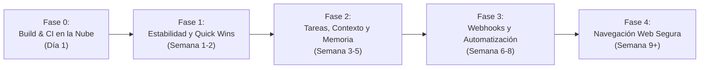

# Guía Paso a Paso: Qué y Cómo Reutilizar de Openstark en Codync

- **Fecha:** Octubre 2026
- **Fuente de análisis:** Checkout local de Openstark (`nightly-labs/openbot`) en [`C:\Users\Edwin Villeda\Documents\Openstark`](file:///C:/Users/Edwin%20Villeda/Documents/Openstark)
- **Repositorio destino:** Codync ([`C:\Users\Edwin Villeda\Documents\Codync`](file:///C:/Users/Edwin%20Villeda/Documents/Codync))
- **Ubicación:** `docs/guia-paso-a-paso-reutilizacion-openstark.md`

---

## 1. Principio Fundamental y Regla de Licencia

> [!IMPORTANT]
> **Contratos e Ideas Sí, Código Fuente No.**  
> Openstark está bajo licencia **PolyForm Noncommercial 1.0.0**, lo que prohíbe el copiado directo de su código a un proyecto con proyección comercial.  
> La reutilización consiste en **adoptar sus especificaciones lógicas, contratos de datos, diagramas de estado y patrones de arquitectura**, reimplementándolos limpiamente dentro de la arquitectura de Codync:
> - **El host Rust (`host/`) es dueño de la lógica**, el estado en SQLite, la cola de turnos y las integraciones.
> - **Los 4 clientes (iOS, Android, Desktop y TUI) son estrictamente clientes de presentación** y comunicación de intenciones.

---

## 2. Mapa de Fases de Adopción (De Menor Esfuerzo / Mayor Impacto a Mayor Complejidad)



---

## FASE 0: Automatización de Compilación en la Nube (Quick Win Operativo)
*Objetivo: Eliminar el 100% del consumo de CPU y RAM de tu laptop al compilar Android, replicando la ventaja de Openstark.*

### Paso 0.1: Adoptar el patrón de runner externo de Openstark
En Openstark ([`.github/workflows/release-android.yml`](file:///C:/Users/Edwin%20Villeda/Documents/Openstark/.github/workflows/release-android.yml#L102-L125)), la compilación pesada nunca corre en la laptop del desarrollador; se delega a runners de GitHub con memoria ampliada (`org.gradle.jvmargs=-Xmx6g`).

**Acción en Codync:**
1. Crear el workflow [`.github/workflows/build-android-fast.yml`](file:///C:/Users/Edwin%20Villeda/Documents/Codync/.github/workflows/build-android-fast.yml) para compilar el APK Debug sin tests ni linters lentos en ~2 minutos.
2. Usar GitHub CLI (`gh workflow run`) para ordenar la compilación desde tu terminal sin prender los ventiladores de tu laptop.

---

## FASE 1: Estabilidad de Turnos y Quick Wins de UX (Alto Impacto / Bajo Esfuerzo)

### Paso 1.1: Pregunta Lateral (*Side Questions*) durante Turnos Largos
* **Referencia Openstark:** Idea 11 (`src/backend/agent/side-question.ts`).
* **El Problema:** Cuando un bot está en un turno largo (analizando código o ejecutando herramientas), la UI se bloquea y el usuario no puede hacerle una pregunta rápida ("¿cuánto falta?" o "¿qué archivo estás editando?") sin interrumpir o reiniciar todo el turno.
* **El Contrato a Reutilizar:**
  - El host acepta un mensaje con el flag `ephemeral: true` o `side_question: true`.
  - El bot responde usando el historial reciente pero **sin añadir la pregunta ni la respuesta a la memoria principal de la conversación**.
  - No compite por la cola de ejecución.
* **Implementación en Codync:**
  - En `host/src/agent/bot/turn.rs`: aprovechar el flag `hidden` que ya existe para rutinas y exponer el método `ask_side_question`.
  - Esfuerzo: **Bajo (1 a 2 días)**.

### Paso 1.2: Delta Buffer para Streaming Suave
* **Referencia Openstark:** Idea 14 (`delta-buffer.ts`).
* **El Problema:** Cuando el LLM escupe tokens rápidamente, emitir un evento SSE o WebSocket por cada token individual satura el hilo de UI en Android e iOS, causando microtirones (*jank*).
* **El Contrato a Reutilizar:**
  - Acumular tokens en un buffer con dos condiciones de vaciado (*flush*):
    - Al pasar **50 ms** sin nuevos tokens.
    - O cuando el buffer alcanza **40 caracteres / 8 tokens**.
* **Implementación en Codync:**
  - En `host/src/agent/bot/updates.rs` (que actualmente tiene un timer rígido de 300 ms), refactorizar a este buffer adaptativo.
  - Esfuerzo: **Bajo (1 día)**.

### Paso 1.3: *Usage-Limit Gate* (Protección contra Agotamiento de API)
* **Referencia Openstark:** Idea 5 (`src/backend/agent/usage-limit-gate.ts`).
* **El Problema:** Si tu cuenta de Claude o OpenAI se queda sin créditos o llega al límite semanal, múltiples bots o rutinas fallan en cascada con 20 errores simultáneos en pantalla.
* **El Contrato a Reutilizar:**
  - Crear una compuerta en memoria por clave: `provider : account : model`.
  - Cuando la API responde con error `429 / InsufficientQuota`:
    - Se abre la compuerta y se calcula el tiempo de espera (si el header `retry-after` está presente) + 30 segundos de gracia.
    - Se pausa la cola de ese proveedor automáticamente; los mensajes entrantes quedan en estado `WaitingForQuota` en vez de fallar.
    - La UI muestra una advertencia unificada: *"Límite de API alcanzado. La cola se reanudará a las 15:30"*.
* **Implementación en Codync:**
  - Agregar `struct UsageLimitGate` en `host/src/agent/bot/queue.rs`.
  - Esfuerzo: **Medio (3 días)**.

### Paso 1.4: Carriles y Estados de Espera Nombrados (*Holds*)
* **Referencia Openstark:** Idea 1 (`carriles y holds`).
* **El Problema:** Actualmente la cola de turnos es una `VecDeque` en memoria que dice "en espera", pero el usuario no sabe *por qué* está esperando.
* **El Contrato a Reutilizar:**
  - Todo elemento en cola tiene un estado explícito:
    - `WaitingForInput`: Esperando aprobación del usuario.
    - `WaitingForSubagent`: Esperando respuesta de otro bot.
    - `WaitingForQuota`: Esperando reinicio de saldo de la API.
    - `Running`: Ejecutando herramientas.
* **Implementación en Codync:**
  - Extender `Queued` en `host/src/agent/bot/queue.rs` y emitir el estado a los clientes vía SSE.
  - Esfuerzo: **Medio (1 semana)**.

---

## FASE 2: Tareas de Agente, Subagentes y Handoff Inteligente

### Paso 2.1: Modelo de Tareas con Ciclo de Vida Visible
* **Referencia Openstark:** Idea 6 (`agent-tasks.ts`).
* **El Concepto:** Convertir peticiones complejas en tareas estructuradas con etapas claras en la interfaz.
* **El Contrato a Reutilizar:**
  - Estados: `Draft` → `Queued` → `Running` → `Blocked(reason)` → `Completed` | `Failed`.
  - Cada tarea tiene una lista de `steps` completados y pendientes.
  - El usuario puede pausar, cancelar o reintentar un paso específico.
* **Implementación en Codync:**
  - Crear tabla `tasks` en SQLite (`host/src/store/schema.rs`).
  - Renderizar en Desktop (`apps/desktop`), Android (`apps/android`) e iOS (`apps/ios`).

### Paso 2.2: Handoff de Contexto con Presupuesto Fijo de Tokens
* **Referencia Openstark:** Idea 20 (`handoff-budget.ts`).
* **El Problema:** Cuando una conversación se vuelve muy larga, el bot olvida instrucciones o la ventana de contexto explota.
* **El Contrato a Reutilizar:**
  - Fijar un límite de tokens de seguridad (ej. 80% del límite de la ventana del modelo).
  - Antes de superar el umbral, generar un resumen estructurado (*Handoff Summary*) con:
    1. Objetivo principal del usuario.
    2. Archivos modificados o analizados.
    3. Decisiones tomadas.
    4. Siguientes pasos inmediatos.
  - Reemplazar el historial antiguo por este resumen y el mensaje del sistema base.
* **Implementación en Codync:**
  - Refinar `host/src/agent/bot/compaction.rs` y el crate `host/crates/memory`.

### Paso 2.3: Descubrimiento Dinámico de Herramientas (*Tool Discovery*)
* **Referencia Openstark:** Idea 23 (`tool-discovery.ts`).
* **El Problema:** Inyectar las descripciones de 50 herramientas MCP en cada prompt inicial consume entre 5,000 y 15,000 tokens en cada turno inútilmente.
* **El Contrato a Reutilizar:**
  - Enviar en el prompt sólo una lista mínima con los nombres y descripciones de 1 línea de las categorías de herramientas disponibles.
  - El bot tiene una meta-herramienta `search_tools(query)`.
  - Cuando el bot necesita interactuar con algo específico (ej. GitHub o Base de Datos), busca la herramienta y el host le inyecta la firma JSON Schema exacta bajo demanda.
  - **Ahorro:** Hasta un 80% de tokens de entrada en cada turno.

---

## FASE 3: Webhooks, Rutinas y Canales Externos

### Paso 3.1: Contrato Robusto de Webhooks Externos
* **Referencia Openstark:** Idea 45 y 46 (`webhook-contracts.ts`).
* **El Concepto:** Permitir que eventos de GitHub, Stripe, Telegram o scripts externos despierten o alimenten a un bot de Codync.
* **El Contrato a Reutilizar:**
  - Verificación criptográfica obligatoria con HMAC (`X-Hub-Signature-256`).
  - Cabecera de deduplicación idempotente: `X-Delivery-Id` (si llega el mismo evento dos veces en 10 minutos, no se ejecuta dos veces).
  - Si el bot está ocupado al momento de recibir el webhook, responder HTTP `503 Service Unavailable` con `Retry-After: 5` sin guardar recibo, permitiendo que el emisor reintente limpiamente.
* **Implementación en Codync:**
  - Ampliar `host/src/routines/hooks.rs` y `host/src/api/http.rs`.

### Paso 3.2: CLI y Automation Server
* **Referencia Openstark:** Idea 48 y 49 (`automation-server.ts`).
* **El Concepto:** Controlar tus bots desde la terminal de tu máquina mediante un subcomando CLI rápido:
  ```sh
  codync bot send --bot "Asistente Rust" "Revisa el PR 124"
  codync routine trigger --id "backup-diario"
  ```
* **Implementación en Codync:**
  - Añadir subcomandos al binario del host en `host/src/main.rs`.

---

## FASE 4: Navegación Web Segura y Computer Use

### Paso 4.1: Snapshot Semántico Acotado
* **Referencia Openstark:** Idea 30 (`semantic-snapshot.ts`).
* **El Problema:** Pasar un árbol DOM completo o capturas de pantalla pesadas satura el contexto y confunde a los agentes.
* **El Contrato a Reutilizar:**
  - Filtrar el DOM para enviar sólo elementos interactivos (botones, inputs, enlaces, formularios).
  - Asignar identificadores numéricos estables (ej. `[12] Botón Enviar`, `[13] Input Correo`).
  - Limitar la respuesta a un máximo de 100 elementos visibles en pantalla.

### Paso 4.2: Inyección Segura de Secretos (*Fill Fields*)
* **Referencia Openstark:** Idea 32 y 33 (`fill-fields.ts`).
* **El Problema:** Si un bot necesita iniciar sesión en un servicio web, pedir la contraseña al usuario o inyectarla en el prompt expone el secreto en los logs del LLM.
* **El Contrato a Reutilizar:**
  - Las credenciales se almacenan en el almacén seguro del host (OS Keychain / Keystore).
  - El LLM sólo emite la intención: `fill_credentials(field_id: 12, secret_key: "GITHUB_TOKEN")`.
  - El motor del host inyecta el valor directamente en el navegador mediante CDP (Chrome DevTools Protocol) sin que la contraseña viaje jamás por el contexto del LLM.

---

## 3. Resumen de Qué NO Reutilizar de Openstark

Para mantener la calidad, seguridad y consistencia de Codync, se debe evitar explícitamente:
1. **El stack frontend SolidJS + Electron de Openstark:** Codync ya cuenta con una UI moderna en React + TypeScript y diseño propio en desktop, SwiftUI en iOS y Jetpack Compose en Android.
2. **El modelo de ejecución sin permisos por defecto:** En Openstark los agentes corren con acceso total al sistema sin confirmación. Codync debe preservar su modelo de seguridad donde las herramientas destructivas requieren aprobación explícita del usuario (`respondPermission`).
3. **Múltiples runtimes desordenados (Bun + Node + Docker):** Codync mantiene un único binario nativo compilado en Rust para el host, lo que garantiza velocidad instantánea y bajo consumo de memoria.

---

## 4. Próxima Acción Inmediata Sugerida

Si deseas comenzar hoy mismo con el primer paso:
1. **Activar la Fase 0 (Build Cloud):** Implementar el archivo [`.github/workflows/build-android-fast.yml`](file:///C:/Users/Edwin%20Villeda/Documents/Codync/.github/workflows/build-android-fast.yml) para que puedas compilar tus cambios en Android directamente en la nube sin gastar recursos de tu laptop.
2. **Implementar el Paso 1.1 (Preguntas laterales):** Es el cambio de menor esfuerzo y mayor impacto en el motor de turnos de Codync.
