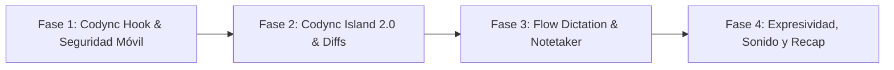

# Investigación exhaustiva: repositorio Coucou y su implementación en Codync

- **Estado:** investigación y plan técnico de integración.
- **Fecha:** 2026-10-21.
- **Repositorio analizado:** [Louis-CFM/coucou](https://github.com/Louis-CFM/coucou) (clonado en `C:\Users\Edwin Villeda\Documents\coucou`).
- **Ámbito en Codync:** Rust Host (`host/`), Desktop Electron (`apps/desktop/`), iOS (`apps/ios/`), Android (`apps/android/`), TUI (`host/src/tui/`) y Relay/Cloud (`relay/`, `cloud/`).
- **Objetivo:** auditar la arquitectura, características y soluciones de Coucou (`NotchBuddy`, `windows/`, `android/`, `relay/`) y definir un catálogo de iniciativas concretas adaptadas a los principios de Codync (*"Host owns the logic"*, paridad multiplataforma y cero dependencias superfluas).

---

## 1. Resumen ejecutivo

**Coucou** (creado por Louis Raillé) es un ecosistema abierto diseñado para supervisar, interactuar y aprobar acciones de agentes de codificación autónomos (Claude Code, Antigravity CLI, Gemini CLI, Cursor, Codex) desde el notch de macOS o una barra flotante en Windows/Linux, extendiéndose al ecosistema móvil (iOS Dynamic Island y Android).

### 1.1 ¿Por qué es relevante para Codync?

Actualmente, **Codync** es un concentrador integral de agentes con soporte para múltiples clientes donde el daemon Rust (`host/`) gestiona bots mediante el protocolo ACP, procesos locales, memoria a largo plazo (`codync-mem`) y llamadas remotas. Aunque Codync ya cuenta con una especificación preliminar de isla de escritorio (`docs/features/notch-island.md`), Coucou ha resuelto con brillantez retos críticos de experiencia de usuario (UX), integración pasiva y control periférico que Codync puede incorporar:

1. **Arquitectura de Hook no invasiva (`coucou-hook`):** Coucou se engancha a las sesiones de agentes que el desarrollador ejecuta en sus terminales favoritas (iTerm, Ghostty, Windows Terminal, VS Code) sin obligarlo a cambiar su flujo de trabajo y sin bloquear la terminal.
2. **Interactividad avanzada en el Notch / Isla:** Arrastrar archivos al notch para alimentar contexto, inspeccionar diffs sintácticos en vivo (`DiffEngine`), responder cuestionarios interactivos (`AskUserQuestion`) y monitorizar cuotas de planes (Anthropic/OpenAI) con cuenta regresiva.
3. **Compañero vivo ("Mochi" / Mascot Engine):** Expresividad procedural dibujada 100 % en código (`Canvas`), seguimiento ocular esférico (`tanh`), animaciones de respiración, emotes y el modo *Free Bot* (mascota flotante de 120 pt en el escritorio que salta a la isla ante alertas).
4. **Flow Dictation y Meeting Notetaker offline:** Pulsar y hablar en cualquier ventana del sistema operativo (pegado simulado con `SendInput` / accesibilidad), transcripción 100 % offline con NVIDIA Parakeet (25 idiomas) vía `sherpa-onnx` en Windows/Linux y FluidAudio en Mac, y grabación local de reuniones sin bots invitados.
5. **Seguridad Biométrica en Android:** Aprobaciones remotas de herramientas peligrosas protegidas por huella dactilar (`BiometricPrompt`), con resúmenes en lenguaje natural seguro (`SafeText`) y protección contra toques accidentales (delay de 600 ms).
6. **Diseño Acústico y Métricas Semanales:** Catálogo de 28 respuestas sonoras personalizables y generación local de resúmenes semanales en infografías (1080×1920) para compartir.

La ventaja técnica fundamental para Codync es que **la implementación de Coucou para Windows/Linux (`windows/src-tauri/src/`) está escrita íntegramente en Rust**, lo que permite adaptar sus algoritmos, llamadas a APIs nativas del SO y lógica directamente al `host/` de Codync respetando la regla inviolable de que el host centraliza la lógica pesada.

---

## 2. Radiografía técnica de Coucou

A continuación se detalla la estructura y funcionamiento de los componentes clave de Coucou analizados en `C:\Users\Edwin Villeda\Documents\coucou`:

```mermaid
flowchart TD
    subgraph Desktop["Entorno Desktop (Mac / Win / Linux)"]
        Term["Terminal del usuario (Claude / Antigravity / Gemini)"] -->|stdin/stdout| Hook["coucou-hook (Rust / Swift)"]
        Hook -->|Named Pipe / Unix Sock| Core["Daemon / App Central"]
        Core --> Island["Notch / Top Island HUD"]
        Core --> FreeMochi["Floating Companion (120 pt)"]
        Core --> FlowEngine["Flow Dictation (sherpa-onnx / Parakeet)"]
        Core --> NotesEngine["Notetaker (Mic + System Loopback)"]
    end

    subgraph Mobile["Entorno Móvil"]
        Core -->|Wi-Fi Local (mDNS + TLS)| AndroidApp["Android App (Biometría + Overlay)"]
        Core -->|APNs sealed push| CloudRelay["Cloudflare Worker Relay"]
        CloudRelay --> iPhoneApp["iPhone (Live Activities + Dynamic Island)"]
    end
```

### 2.1 Ecosistema de módulos en Coucou

| Módulo | Ruta en Coucou | Tecnología | Función clave |
|---|---|---|---|
| **Mac Native** | `NotchBuddy/` | Swift 6, SwiftUI, AppKit | Aplicación de notch para macOS, detección física de safe area, ventanas `NSPanel` nivel `mainMenu + 3`, audio FluidAudio. |
| **CoucouKit** | `NotchBuddy/Sources/CoucouKit/` | Swift 6 | Biblioteca compartida Mac/iOS: `BotEngine.swift` (animación procedural), `DiffEngine.swift` (cálculo de hunks), catálogo de píldoras. |
| **Windows / Linux** | `windows/src-tauri/` | Rust (Tauri 2 backend) | Gestión de ventanas transparentes, pipes con nombre, hooks globales de teclado en Windows (`os_windows.rs`), Linux X11/Wayland. |
| **Hook Relay** | `windows/hook/` & `HookServer.swift` | Rust (`main.rs`) / Swift | Binario relay que intercepta hooks de agentes CLI, normaliza eventos, no bloquea jamás (`timeout 300ms`) y pasa JSON al HUD. |
| **Android** | `android/` | Kotlin, Jetpack Compose | App con sincronización LAN (mDNS), biometría obligatoria para autorizaciones, overlay sobre cutout de cámara y widgets. |
| **Relay Push** | `relay/` | Cloudflare Workers | Reenvío de Live Activities y notificaciones APNs sin almacenar estado ni claves privadas del usuario. |

### 2.2 Patrones de diseño notables en Coucou

1. **Nunca bloquear al agente (`docs/CLAUDE.md`):** Si la app o el pipe no responden en 300 ms, `coucou-hook` finaliza con código 0 y la terminal continúa su flujo estándar como si el notch no existiera.
2. **Cero telemetría y privacidad total:** Todo el historial de sesiones (`recap.json`), estadísticas y grabaciones de audio viven exclusivamente en disco local (`%LOCALAPPDATA%` o `~/.local/share`). Las grabaciones del notetaker se eliminan tras generar el texto.
3. **Dibujo procedural sin dependencias:** El avatar no usa Lottie, Rive ni secuencias de imágenes; todo se dibuja sobre `Canvas` evaluado en `TimelineView` (o `requestAnimationFrame` en web) con cálculo trigonométrico en tiempo real.
4. **Matemáticas de mirada natural:** La posición de las pupilas no es lineal: aplica `tanh((mouse.x - origin.x) / 260)` para una compresión elástica suave y creíble.

---

## 3. Matriz comparativa: Coucou vs. Codync

| Dimensión | Coucou | Codync actual | Oportunidad para Codync |
|---|---|---|---|
| **Arquitectura de agentes** | Ingesta pasiva de terminales vía CLI Hooks (`claude`, `gemini`, `agy`). | Orquestación directa de subprocesos vía protocolo ACP en el `host/`. | **Híbrida:** Mantener ACP y añadir un `codync-hook` para monitorizar sesiones de terminales externas. |
| **Isla / Notch Desktop** | Notch en Mac (`NSPanel`), barra flotante en Win/Linux, multi-monitor con `followMouse`, diffs interactivos y drag-and-drop. | Ventana fija 720×300 en Electron (`island.ts`), estados básicos, sin drag-and-drop de archivos ni seguimiento multi-monitor. | **Codync Island 2.0:** Detección de display activa, drag-and-drop de archivos al bot, diff interactivo con hunks colapsables. |
| **Avatares y Mascota** | "Mochi": Squircle animado, pupilas elásticas, disfraces, modo escritorio flotante (120 pt), arrastrar a ventana. | Halftone de puntos (8 siluetas, 11 colores), parpadeo y rotación en `working`. | **Halftone Viviente + Free Bot:** Añadir seguimiento ocular `tanh`, fatiga/mareo, y modo bot flotante desacoplable. |
| **Voz y Dictado** | Flow Dictation global en cualquier app con atajo Push-to-Talk, transcripción offline Parakeet (25 idiomas) y Notetaker de llamadas. | Dictado de composer solo en Mac (`codync-speech`), llamadas manos libres Grok-style, sin dictado global ni en Win/Linux. | **Flow Dictation + Notetaker:** Soporte global multiplataforma con `sherpa-onnx` en el host y minutas automáticas a `codync-mem`. |
| **Seguridad Móvil (Android)** | Biometría obligatoria (`BiometricPrompt`) para autorizar, delay antitoques de 600 ms, comandos ocultos tras `SafeText`. | Aprobaciones mediante tarjetas en chat/notificación estándar sin desafío biométrico estricto. | **Biometría en Android/iOS:** Exigir huella/FaceID para comandos de alto riesgo en ambas plataformas móviles. |
| **Diseño Acústico** | 28 sonidos WAV de respuesta rápida (alertas, aprobación, completado, pokes), carpeta de sonidos reemplazable. | Interfaz puramente visual (sin retroalimentación acústica distintiva). | **Sound System:** Integración de sonidos de baja latencia con personalización de temas sonoros en `%APPDATA%\Codync\sounds`. |
| **Analítica y Resumen** | Resumen semanal local (Weekly Recap) con generación de imagen 1080×1920 compartible. | Analíticas técnicas en SQLite de tokens, llamadas y límites (`features/analytics.md`). | **Developer Weekly Digest:** Tarjeta visual de productividad semanal generada localmente para los bots del usuario. |
| **Píldoras Multimedia** | Control de Spotify / Apple Music en el notch con baile rítmico del avatar. | Sin integración multimedia en el shell. | **Media Pill:** Píldora de control multimedia opcional integrada con la actividad de concentración del bot. |

---

## 4. Catálogo de iniciativas para Codync (Fichas técnicas)

Se proponen **ocho iniciativas estratégicas** integrables en el ecosistema Codync, ordenadas por viabilidad, valor arquitectónico e impacto de usuario.

---

### INIC-01: Codync Hook Bridge (Ingesta de sesiones CLI externas)

- **Prioridad:** Alta.
- **Ámbito:** `host/crates/codync-hook`, `host/src/api/`, `apps/desktop/`, `apps/ios/`, `apps/android/`.
- **Concepto adoptado:** El mecanismo `coucou-hook` de Coucou (`windows/hook/src/main.rs`).
- **Problema en Codync:** Hoy Codync solo supervisa los bots que él mismo arranca mediante ACP en su base de datos local. Los desarrolladores suelen ejecutar `claude` (Claude Code), `gemini` o `agy` (Antigravity CLI) directamente en sus terminales locales. Codync no tiene visibilidad de estas sesiones externas.
- **Solución propuesta:**
  1. Crear un binario ultraligero `codync-hook` (en Rust) distribuido con el paquete de Codync.
  2. Implementar un servidor IPC en `host/src/hook_server.rs` escuchando en un Named Pipe en Windows (`\\.\pipe\codync-hook-<sid>`) y un Unix Socket en macOS/Linux (`~/.codync/hook.sock`).
  3. `codync-hook` recibe el evento en JSON por `stdin`, captura las variables de entorno de la terminal (`TERM_PROGRAM`, `ITERM_SESSION_ID`, `WT_SESSION`, `cwd`, tty), conecta con un timeout estricto de 300 ms y despacha el evento al Host.
  4. Si el evento es `PermissionRequest`, `codync-hook` espera hasta 110 segundos a que el usuario autorice o deniegue desde la Isla de Codync, la app de iOS o Android. Si expira o Codync no está abierto, sale con código 0 y deja que la terminal pregunte de forma interactiva.
  5. Soporte para el comando "Saltar a la terminal" (`Ctrl+Alt+T` o botón en la UI): usando AppleScript en macOS o `SetForegroundWindow` / Windows Terminal IPC en Windows.
- **Dónde vive el dato:** Las sesiones externas se registran en una tabla efímera en el host (`external_sessions`) y se publican en el flujo de eventos SSE (`rev`) para los clientes.
- **Criterios de aceptación:**
  - `codync-hook` jamás congela o retrasa la terminal si Codync Host está cerrado (tiempo de retorno < 15 ms al fallar conexión).
  - Un `PermissionRequest` en Claude Code genera una tarjeta de aprobación inmediata en la Isla de escritorio y en la notificación de iOS/Android.

---

### INIC-02: Codync Island 2.0 (Notch avanzado, multi-monitor y Drag-and-Drop)

- **Prioridad:** Alta.
- **Ámbito:** `apps/desktop/src/main/island.ts`, `apps/desktop/src/renderer/views/island/`, `shared/island.ts`.
- **Concepto adoptado:** La geometría, transiciones, drag-and-drop de archivos y diff en vivo de Coucou (`NotchBuddy/Sources/App/IslandWindowController.swift` y `SPEC.md`).
- **Mejoras sobre la implementación actual:**
  1. **Multi-display con `followMouse`:** Actualmente `island.ts` queda fija en la pantalla del notch o en la pantalla principal. Adoptar la lógica de resolución de pantallas de Coucou: modo fijo en pantalla con notch, modo barra superior compacta (24 pt) para pantallas secundarias/externas, o modo dinámico `followMouse` que traslada la isla a la pantalla activa donde esté trabajando el usuario.
  2. **Drag & Drop de archivos en el Notch:** Al arrastrar un archivo o carpeta desde el Explorador/Finder sobre la forma del notch, el avatar de Codync se transforma en una caja receptora animada. Al soltarlo, el archivo se transfiere automáticamente como un adjunto (`file-attachments.md`) a la sesión del bot activo.
  3. **Diff Card interactivo en tiempo real (`DiffEngine`):** Integrar un visor de hunks sintácticos en la tarjeta de resumen de la isla cuando el bot ejecuta `Edit` o `Write`. Muestra el desglose de líneas añadidas/eliminadas (`+12 -4`) y permite colapsar/expandir el diff sin tener que abrir la ventana completa de Codync.
  4. **Tarjetas de Cuestionario (`AskUserQuestion`):** Cuando un bot solicita aclaraciones con opciones múltiples o texto libre, la isla muestra un formulario fluido interactivo de respuesta rápida sin forzar al usuario a ir al chat.
- **Criterios de aceptación:**
  - El drag-and-drop sobre el notch no interfiere con clics de otras aplicaciones cuando el cursor no lleva archivos (conservación de `setIgnoreMouseEvents` con padding de 8 pt).
  - El visor de diff recorta archivos mayores de 200 KB o 4000 líneas para proteger la fluidez a 60 fps.

---

### INIC-03: Expresividad y Companion ("Free Bot" en el escritorio)

- **Prioridad:** Media / Alta.
- **Ámbito:** `apps/desktop/`, `apps/ios/Kit/Sources/CodyncUI/Controls/AvatarView.swift`, `apps/android/design/Avatar.kt`.
- **Concepto adoptado:** El motor de movimiento ocular de `BotEngine.swift` y el panel flotante de `DesktopMochi.swift`.
- **Solución técnica en Codync:**
  1. **Seguimiento ocular procedural para avatares Halftone:**
     - En lugar de mantener las pupilas del avatar Halftone en posición estática, incorporar la fórmula no lineal:
       $$\text{lookX} = \tanh\left(\frac{x_{\text{mouse}} - x_{\text{avatar}}}{260}\right), \quad \text{lookY} = -\tanh\left(\frac{y_{\text{mouse}} - y_{\text{avatar}}}{200}\right)$$
     - Aplicar micropestañeos aleatorios (cada 3.5 a 6.5 segundos) y dilatación pupilar durante el estado `working`.
     - 0 % de consumo de CPU cuando la ventana o la isla están minimizadas o en suspensión de pantalla (`TimelineView.animation(paused: isPaused)`).
  2. **Modo "Free Bot" (Mascota de escritorio desacoplada):**
     - Permitir arrastrar el avatar fuera del notch hacia cualquier parte del escritorio.
     - Se materializa como una ventana flotante transparente e independiente de 120 pt que acompaña al usuario mientras programa.
     - Reacciona a toques (irritación, mareo si se insiste), reproduce una animación de vuelo de vuelta al notch cuando surge una aprobación crítica, y regresa a su posición en el escritorio tras responder.
  3. **Arrastrar el Bot sobre ventanas externas para contexto:**
     - Al arrastrar el avatar flotante sobre una ventana (ej. un navegador o VS Code), Codync captura los metadatos de esa ventana (título, proceso, ruta de archivo o captura de pantalla mediante `apps/screen-*`) y lo inyecta como contexto para el bot.
- **Criterios de aceptación:**
  - El bot flotante no interfiere con el foco del teclado de otras ventanas (`NSWindow.Level.floating`, sin activar app).
  - Al presionar un atajo global configurable (`Ctrl+Alt+D` / `⌥⌘D`), el bot regresa instantáneamente al notch.

---

### INIC-04: Flow Dictation Global y Local Call Notetaker

- **Prioridad:** Alta.
- **Ámbito:** `host/crates/flow/`, `host/src/voice/`, `apps/desktop/src/main/speech.ts`.
- **Concepto adoptado:** La arquitectura de dictado global de Coucou (`windows/src-tauri/src/flow/`) y el sistema de notas de llamadas (`notes/`).
- **Problema en Codync:** En `docs/features/voice-call.md`, el dictado en escritorio se declara como *"macOS only"* mediante un helper auxiliar (`codync-speech`). Windows y Linux no disponen de dictado de composer y no existe ningún mecanismo para dictar texto fuera de la ventana de Codync.
- **Solución técnica:**
  1. **Flow Dictation Multiplataforma en el Host Rust:**
     - Incorporar en el host el hook de teclado de bajo nivel para push-to-talk (`SetWindowsHookExW` en Windows, `CGEventTap` en macOS, `evdev`/X11 en Linux).
     - Al mantener pulsada la tecla designada (ej. `Fn` o tecla de menú derecha), se activa la captura de micrófono a 16 kHz mono.
     - Al soltar la tecla, el motor de inferencia local transcribe el audio.
     - Simular pegado en el campo de texto activo mediante inyección de eventos (`SendInput` con `Ctrl+V` en Windows, `CGEvent` con `⌘V` en Mac) y restaurar inmediatamente el contenido previo del portapapeles.
  2. **Motor STT Offline Unificado:**
     - En macOS Apple Silicon: Integrar NVIDIA Parakeet (25 idiomas) a través del Neural Engine (vía FluidAudio o CoreML).
     - En Windows y Linux: Utilizar `sherpa-onnx` en Rust compilado en el host con el modelo Parakeet transducer offline.
     - Descarga bajo demanda validada por SHA-256 en `%LOCALAPPDATA%\Codync\models`, garantizando funcionamiento 100 % sin conexión a internet y sin costes de API.
  3. **Notetaker de reuniones sin bots invitados:**
     - Grabar simultáneamente el micrófono del usuario y el loopback del sistema operativo (WASAPI loopback en Windows, BlackHole / CoreAudio en Mac, PipeWire en Linux).
     - Diarización de interlocutores con el modelo de voz offline de `sherpa-onnx`.
     - Generación de resumen de la reunión, decisiones y lista de tareas pendientes vinculadas directamente a la memoria de Codync (`codync-mem`).
- **Criterios de aceptación:**
  - Dictar un párrafo de 50 palabras en cualquier editor (VS Code, Word, navegador) toma menos de 400 ms entre soltar la tecla y ver el texto pegado.
  - El portapapeles recupera su contenido previo tras la operación de pegado.

---

### INIC-05: Seguridad y UX Biométrica en Android & iOS

- **Prioridad:** Alta.
- **Ámbito:** `apps/android/app/`, `apps/android/core/`, `apps/ios/`.
- **Concepto adoptado:** El modelo de seguridad y permisos de Coucou Android (`android/PERMISSION.md`, `SafeText.kt`, `IslandOverlay.kt`).
- **Mejoras para Codync:**
  1. **Aprobaciones con autenticación biométrica obligatoria:**
     - Para herramientas de alto impacto (ej. ejecución de comandos de terminal `bash`, modificación de claves o borrado de archivos), exigir el uso de `BiometricPrompt` (huella o reconocimiento facial) antes de despachar el evento `Allow` al host.
     - Las acciones de `Deny` se ejecutan con un solo toque sin requerir biometría.
  2. **Protección antitoques accidentales en el bolsillo:**
     - Ignorar toques en la notificación o diálogo de aprobación durante los primeros 600 ms tras el encendido de pantalla para evitar pulsaciones involuntarias al sacar el dispositivo.
     - Expiración automática de solicitudes de permiso en 120 segundos.
  3. **Normalización `SafeText` y `ToolLabels`:**
     - En pantallas bloqueadas o notificaciones públicas, traducir comandos crudos y rutas internas a descripciones semánticas amigables ("Editar archivo de configuración", "Instalar paquete npm"), requiriendo un toque explícito y autenticación para revelar el comando bash o script completo.
  4. **Island flotante en Android sobre cutout de cámara:**
     - Implementar `IslandOverlay` en Android (usando el permiso de superposición sobre otras aplicaciones) para desplegar un notch interactivo sutil mientras los bots trabajan en el ordenador.
- **Criterios de aceptación:**
  - Intentar aprobar un comando destructivo en Android falla de inmediato si el usuario no valida su huella digital.
  - La superposición de cámara en Android se oculta automáticamente 10 segundos después de finalizar la tarea del bot.

---

### INIC-06: Sistema Acústico y Personalización de Sonidos

- **Prioridad:** Media.
- **Ámbito:** `apps/desktop/src/main/sound.ts`, `apps/desktop/src/renderer/`, `apps/ios/`, `apps/android/`.
- **Concepto adoptado:** El diseño sonoro de 28 WAVs artesanales de Coucou y la carpeta de reemplazo en disco (`sounds.rs`).
- **Solución técnica:**
  1. Diseñar un conjunto de 12 a 20 efectos sonoros sutiles de baja latencia para Codync:
     - `task_start`: Inicio de turno de un bot.
     - `task_finish`: Bot finaliza satisfactoriamente.
     - `task_error`: Error de ejecución o parada.
     - `permission_alert`: Alerta de permiso pendiente de aprobación.
     - `bot_poke`: Interacción táctil con el avatar.
     - `flow_start` / `flow_stop`: Inicio y fin de escucha en Flow Dictation.
  2. Habilitar la carpeta de personalización local:
     - `%APPDATA%\Codync\sounds` en Windows, `~/.config/codync/sounds` en Linux y `~/Library/Application Support/Codync/sounds` en macOS.
     - Los usuarios pueden depositar archivos `.wav` o `.mp3` con nombres coincidentes para sobreescribir los sonidos del sistema.
  3. Modos de silencio rápido: Atajo global para silenciar todas las respuestas sonoras (`Ctrl+Alt+S`).
- **Criterios de aceptación:**
  - Los sonidos se reproducen mediante canales de audio no bloqueantes con latencia inferior a 25 ms.
  - Si el usuario añade un archivo `task_finish.wav` válido en la carpeta de configuración, el sistema lo carga inmediatamente tras recargar preferencias.

---

### INIC-07: Weekly Developer Digest (Resumen Semanal Local)

- **Prioridad:** Media.
- **Ámbito:** `host/src/analytics/`, `host/src/store/`, `apps/desktop/src/renderer/views/recap/`.
- **Concepto adoptado:** El motor `recap.rs` y el generador de infografías de Coucou.
- **Solución técnica:**
  1. Registrar en una tabla SQLite local (`bot_recap_history`) las estadísticas anonimizadas de cada turno:
     - Tiempo activo del bot.
     - Nombre del proyecto (último componente de la ruta, jamás la ruta completa).
     - Conteo de archivos modificados y balance de líneas `+N -M`.
     - Herramientas más ejecutadas (ej. `Bash`, `Edit`, `Read`).
  2. Ventana deslizante de 12 semanas con un tamaño máximo en disco de 2 MB para evitar degradación.
  3. Cada lunes por la mañana, Codync genera un panel de resumen visual ("Tu semana con Codync") con opción de exportar una imagen vertical de 1080×1920 píxeles con el avatar del bot, horas ahorradas y logros de código, lista para compartir.
- **Criterios de aceptación:**
  - En ningún caso se envían las estadísticas de resumen a la nube ni a telemetría externa (100 % local).
  - La generación de la imagen PNG de 1080×1920 se realiza en menos de 1.5 segundos utilizando HTML5 Canvas / Skia.

---

### INIC-08: Media Pill & Integraciones de Servicios

- **Prioridad:** Baja / Complementaria.
- **Ámbito:** `apps/desktop/src/renderer/views/island/`, `host/src/integrations/`.
- **Concepto adoptado:** Las píldoras de Spotify, Apple Music y servicios de Coucou (`spotify.rs`, `PillCatalog.swift`).
- **Solución técnica:**
  1. Incorporar una píldora multimedia opcional en la isla de Codync:
     - Detecta la reproducción activa en Spotify (mediante el API local de Spotify Web Helper o AppleScript en Mac).
     - Muestra el título, artista y portada del álbum en un chip compacto de 132×34 pt.
     - El avatar del bot sincroniza una sutil animación de balanceo/baile al compás mientras haya música sonando y no esté trabajando en tareas críticas.
  2. Píldoras de estado pasivo de GitHub / CI:
     - Monitorización compacta de PRs abiertos y estado de compilación de CI en el repositorio activo del bot.
- **Criterios de aceptación:**
  - La integración musical es puramente opcional y se desactiva por defecto en los ajustes de la isla.

---

## 5. Plan de implementación por fases

Para garantizar estabilidad y seguir la regla de que cada cambio entregado sea modular, probado y verificado de extremo a extremo, se establece el siguiente cronograma en cuatro fases:



### Fase 1: Puente de Agentes Externos y Seguridad Móvil (2 - 3 semanas)
- [ ] Desarrollar `host/crates/codync-hook` en Rust (soporte para named pipes en Windows y sockets Unix en Mac/Linux).
- [ ] Implementar la normalización de eventos para Claude Code, Antigravity CLI y Gemini CLI.
- [ ] Integrar el dispatch de eventos de aprobación hacia el Host de Codync.
- [ ] Actualizar la app de Android (`apps/android/`) con `BiometricPrompt` obligatorio para aprobaciones remotas.
- [ ] Implementar `SafeText` y protecciones antitoques accidentales de 600 ms en Android.

### Fase 2: Evolución de la Isla y Visor de Diffs (3 - 4 semanas)
- [ ] Rediseñar la ventana `apps/desktop/src/main/island.ts` para soporte dinámico multimonitor (`followMouse`).
- [ ] Implementar el visor de diff interactivo en tiempo real (`DiffEngine`) con hunks colapsables.
- [ ] Soporte para drag & drop de archivos directo sobre el notch con ingesta inmediata hacia el bot en foco.
- [ ] Soporte de cuestionarios interactivos (`AskUserQuestion`) en la isla.

### Fase 3: Flow Dictation y Meeting Notetaker (3 - 4 semanas)
- [ ] Implementar el hook de teclado global en Rust para push-to-talk (`WH_KEYBOARD_LL` en Windows, `CGEventTap` en macOS).
- [ ] Integrar `sherpa-onnx` en el host daemon para transcripción local offline con NVIDIA Parakeet.
- [ ] Implementar simulación de pegado automático y restauración transparente del portapapeles.
- [ ] Desarrollar la captura combinada de audio (micrófono + loopback del sistema) para minutas y resúmenes de reuniones en `codync-mem`.

### Fase 4: Expresividad, Diseño Acústico y Weekly Digest (2 - 3 semanas)
- [ ] Incorporar el seguimiento ocular elástico con `tanh` en los avatares Halftone de escritorio, iOS y Android.
- [ ] Diseñar e implementar el modo "Free Bot" (ventana flotante desacoplada de 120 pt en el escritorio).
- [ ] Integrar el subsistema de sonido de baja latencia con soporte para personalización en `%APPDATA%\Codync\sounds`.
- [ ] Crear el recopilador local de métricas semanales y la plantilla de exportación gráfica de 1080×1920.

---

## 6. Riesgos técnicos y estrategias de mitigación

| Riesgo detectado | Impacto | Estrategia de mitigación adoptada |
|---|---|---|
| **Bloqueo accidental de la terminal del usuario por el hook** | Crítico | Timeout incondicional de 300 ms en el handshake de conexión; si el host no responde, el binario finaliza de inmediato con código 0. |
| **Consumo excesivo de CPU por seguimiento del cursor** | Alto | Pausar por completo el renderizado del avatar (`TimelineView(paused: true)` o cancelar el loop de animación) en cuanto la isla entra en modo `hidden` o la pantalla entra en reposo. |
| **Conflictos de portapapeles durante el pegado en Flow Dictation** | Medio | Bloquear el hilo de entrada durante 40 ms para despachar la simulación de teclas y restaurar el contenido del portapapeles a través de una copia en memoria inmediata. |
| **Tamaño de modelos de reconocimiento de voz offline** | Medio | No empaquetar los modelos en el instalador base; ofrecer descarga opcional con un solo clic (~650 MB para Parakeet), validando checksums SHA-256 antes de guardarlos. |
| **Fragmentación de permisos entre sistemas operativos (Windows vs Mac)** | Medio | Centralizar las políticas de seguridad en el Host Rust (`host/`), exponiendo únicamente interfaces abstractas a los clientes UI. |

---

## 7. Conclusión

El análisis detallado del repositorio [Louis-CFM/coucou](https://github.com/Louis-CFM/coucou) revela una arquitectura moderna, extraordinariamente enfocada en el flujo de trabajo del desarrollador y con soluciones de ingeniería elegantes para problemas complejos (hooks no bloqueantes, matemáticas visuales en Canvas, control acústico y dictado nativo de alto rendimiento).

Para **Codync**, adoptar estas innovaciones no requiere rehacer la arquitectura existente, sino expandirla con precisión:
1. `codync-hook` abre Codync a todas las terminales del desarrollador.
2. La Isla 2.0 y la expresividad ocular transforman a los bots en compañeros de trabajo dinámicos y empáticos.
3. Flow Dictation y el Notetaker offline resuelven la brecha histórica de voz en Windows y Linux.
4. La biometría móvil consolida a Codync como una plataforma de control remoto de máxima seguridad.

Toda la base de código de Coucou permanece clonada y accesible localmente en `C:\Users\Edwin Villeda\Documents\coucou` para consulta directa de implementaciones de referencia durante las fases de desarrollo.

---

## 8. Estado de implementación

- **INIC-01 — Hook Bridge: hecho.** `codync-host hook` (relay no bloqueante, presupuesto 300 ms, 115 s solo para
  aprobaciones), POST /ingest/hook, normalización de Claude Code / Gemini CLI / Antigravity / Codex / Copilot CLI,
  respuesta por agente (`reply.rs`), sesiones externas como bots con transcript, diffs, aprobaciones, pushes y
  limpieza (`SessionEnd`, reinicio del host, 6 h sin eventos), y `codync-host hooks install|uninstall|status` para
  Claude Code. Detalle: [features/terminal-sessions.md](../features/terminal-sessions.md).
- **INIC-05 — Seguridad móvil: Android hecho, iPhone pendiente por decisión del proyecto.** En Android, aprobar un
  comando o un cambio de archivos pide huella, rostro o PIN (`BiometricPrompt`), denegar es un toque, y los toques
  durante los primeros 600 ms tras encender la pantalla se ignoran. La tarjeta, la respuesta rápida del roster y
  las aprobaciones por voz pasan por el mismo guardián (`Approvals.kt`). iOS queda como estaba.
- **Paridad:** el escritorio (macOS, Linux y Windows) y la TUI muestran las sesiones externas y sus tarjetas sin
  cambios propios; el compositor del escritorio y el de Android explican que la sesión se responde en la terminal.
- **INIC-02 — Isla 2.0: hecho salvo los cuestionarios.** Posición configurable (pantalla con notch, pantalla bajo el
  puntero con seguimiento, o pantalla principal) desde el menú de la bandeja; arrastrar archivos sobre la isla los
  envía al bot en foco (rutas del SO, 20 archivos y 100 MB cada uno como el compositor); y la tarjeta de aprobación
  muestra `+N −M` por archivo con las líneas cambiadas al hacer clic. Pendiente: responder `AskUserQuestion` desde
  la isla (y desde el resto de clientes), que necesita el mapa de respuestas y el `updatedInput` del hook.
- **INIC-03 — Expresividad: hecho el seguimiento ocular de escritorio.** Los personajes halftone en movimiento miran
  al puntero con `tanh` (suavizado hacia el borde de la cara) y respiran un ~1 %; uno inactivo se dibuja una vez y
  no consume cuadros, y con Reducir movimiento no se anima nada. Pendiente: el «Free Bot» flotante y el seguimiento
  en Android/iOS.
- **Siguiente:** INIC-04 (Flow Dictation y Notetaker offline), INIC-06 (sonidos), INIC-07 (resumen semanal) e INIC-08.

- **Desvío de transporte respecto a esta ficha:** el relay no usa named pipes ni sockets Unix, sino el HTTP local que ya existe (loopback + token de `~/.codync/token`). Se evita así código Win32 nuevo y el hook entra por la misma puerta autenticada que el resto de helpers locales; el binario sigue siendo ultraligero porque el relay es un subcomando de `codync-host` (hook) y no un crate aparte.
