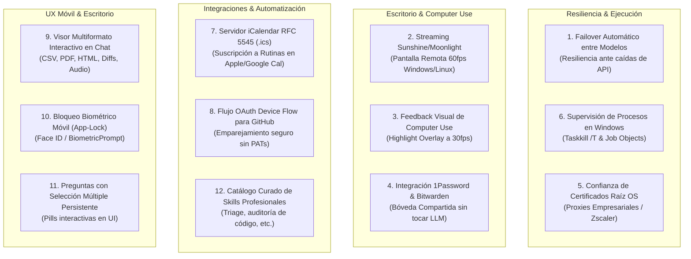

# Investigación Profunda: Qué Implementar de Openstark en Codync para una Aplicación Completa

- **Fecha:** Octubre 2026
- **Fuente de Análisis:** Checkout de Openstark (`nightly-labs/openbot` v0.47.1 y fork v0.48.2) en [`C:/Users/Edwin Villeda/Documents/Openstark`](file:///C:/Users/Edwin%20Villeda/Documents/Openstark) y [`C:/Users/Edwin Villeda/Documents/openstark-0.47.1`](file:///C:/Users/Edwin%20Villeda/Documents/openstark-0.47.1).
- **Proyecto Destino:** Codync en [`C:/Users/Edwin Villeda/Documents/Codync`](file:///C:/Users/Edwin%20Villeda/Documents/Codync).
- **Ubicación:** `docs/nuevo thndr/investigacion-profunda-capacidades-openstark-codync.md`
- **Objetivo:** Auditar exhaustivamente qué componentes ya están implementados en Codync, qué ideas ya están documentadas como planes de implementación (y en qué archivos específicos), y descubrir todas las capacidades novedosas de Openstark que **NO** están repetidas ni documentadas, para convertir a Codync en una plataforma completa, robusta y autónoma.

---

## 1. Principio Fundamental y Reglas de Arquitectura

> [!IMPORTANT]
> **Contratos e Ideas Sí, Código Fuente No.**  
> Openstark está licenciado bajo **PolyForm Noncommercial 1.0.0**, lo que impide el copiado directo de código a un proyecto con proyección comercial como Codync (Apache 2.0).  
> La reutilización debe centrarse en **contratos de datos, diagramas de estado, flujos de resiliencia y especificaciones funcionales**, reimplementados limpiamente bajo los estándares de Codync:
> 1. **El Host Rust (`host/`) es dueño absoluto de la lógica**: orquestación, SQLite, cola de turnos, procesos de agentes, credenciales y validaciones.
> 2. **Los cuatro clientes (Desktop Electron, iOS SwiftUI, Android Jetpack Compose y Terminal TUI) son estrictamente capas de presentación e intención**: no contienen lógica de negocio propia ni divergencias de comportamiento.

---

## 2. Auditoría: Lo que YA ESTÁ IMPLEMENTADO en Codync

Para evitar duplicidades, se auditó el código fuente actual de Codync:

| Área | Estado en Codync | Archivos de Evidencia en Codync |
| :--- | :--- | :--- |
| **Motor de Turnos & Cola** | Actor por bot con mailbox `Cmd`, cola `Queued` en memoria (`VecDeque`), turnos con ciclo de vida, soporte de turnos `hidden` para rutinas. | [`host/src/agent/bot/mod.rs`](file:///C:/Users/Edwin%20Villeda/Documents/Codync/host/src/agent/bot/mod.rs), [`queue.rs`](file:///C:/Users/Edwin%20Villeda/Documents/Codync/host/src/agent/bot/queue.rs), [`turn.rs`](file:///C:/Users/Edwin%20Villeda/Documents/Codync/host/src/agent/bot/turn.rs) |
| **Protocolo de Agentes (ACP)** | Cliente ACP universal para Claude Code, Codex, Cursor, Gemini, OpenCode, Pi, etc. Stream con eventos SSE (chunks, thoughts, tool_calls, plans). Auto-aprobación y solicitud de permisos `NeedsInput`. | [`host/src/agent/acp.rs`](file:///C:/Users/Edwin%20Villeda/Documents/Codync/host/src/agent/acp.rs), [`process.rs`](file:///C:/Users/Edwin%20Villeda/Documents/Codync/host/src/agent/process.rs), [`updates.rs`](file:///C:/Users/Edwin%20Villeda/Documents/Codync/host/src/agent/bot/updates.rs) |
| **Compactación y Memoria** | Compactación de contexto al alcanzar 20k tokens. Crate propio `codync-mem` con SQLite para notas, archivos de memoria y ciclo de "sueños" (*dreams*) con vector search. | [`host/src/agent/bot/compaction.rs`](file:///C:/Users/Edwin%20Villeda/Documents/Codync/host/src/agent/bot/compaction.rs), [`host/crates/memory/src/lib.rs`](file:///C:/Users/Edwin%20Villeda/Documents/Codync/host/crates/memory/src/lib.rs) |
| **Colaboración entre Bots** | MCP server integrado `team` que permite a los bots descubrirse y enviarse peticiones asíncronas (`ask_bot`, `message_bot`). | [`host/src/chat/team.rs`](file:///C:/Users/Edwin%20Villeda/Documents/Codync/host/src/chat/team.rs) |
| **Grupos y Respuestas en Hilo** | Chats grupales con orquestación por turnos de hasta 3 rondas y menciones `@bot`. Hilos de respuesta independientes. | [`host/src/chat/group.rs`](file:///C:/Users/Edwin%20Villeda/Documents/Codync/host/src/chat/group.rs) |
| **Motor de Rutinas** | Ejecución periódica (intervalo, cron) y webhooks HTTP con firma HMAC (`X-Hub-Signature-256`) y deduplicación de entregas (`delivery_id`). | [`host/src/routines/mod.rs`](file:///C:/Users/Edwin%20Villeda/Documents/Codync/host/src/routines/mod.rs), [`hooks.rs`](file:///C:/Users/Edwin%20Villeda/Documents/Codync/host/src/routines/hooks.rs), [`runner.rs`](file:///C:/Users/Edwin%20Villeda/Documents/Codync/host/src/routines/runner.rs) |
| **Computer Use** | Integración del daemon `cua-driver` (16 herramientas de interfaz, modo background, inyección `type_login`). | [`host/src/screen/cua.rs`](file:///C:/Users/Edwin%20Villeda/Documents/Codync/host/src/screen/cua.rs), [`packaging/cua-driver/`](file:///C:/Users/Edwin%20Villeda/Documents/Codync/packaging/cua-driver/) |
| **Pantalla Remota (WebRTC)** | Streaming WebRTC hardware H.264 para macOS y Linux. Enlace con Cloudflare Realtime TURN. | [`host/src/screen/mod.rs`](file:///C:/Users/Edwin%20Villeda/Documents/Codync/host/src/screen/mod.rs), [`apps/screen-macos/`](file:///C:/Users/Edwin%20Villeda/Documents/Codync/apps/screen-macos/) |
| **Almacén Seguro de Credenciales** | Bóveda local cifrada con XChaCha20-Poly1305 respaldada por el Keychain de macOS y Secret Service en Linux. | [`host/src/market/vault.rs`](file:///C:/Users/Edwin%20Villeda/Documents/Codync/host/src/market/vault.rs) |
| **Marketplace & Skills** | Registro MCP, soporte de carpetas de instrucciones `SKILL.md` bajo `~/.codync/skills/`, apps de Composio. | [`host/src/market/mod.rs`](file:///C:/Users/Edwin%20Villeda/Documents/Codync/host/src/market/mod.rs), [`skills.rs`](file:///C:/Users/Edwin%20Villeda/Documents/Codync/host/src/market/skills.rs) |
| **Llamadas de Voz** | Canal de voz WebRTC manos libres en cliente móvil. | [`host/src/voice/mod.rs`](file:///C:/Users/Edwin%20Villeda/Documents/Codync/host/src/voice/mod.rs) |
| **Notch Island en Escritorio** | Interfaz flotante adaptable en la parte superior / notch en macOS, Windows y Linux con seguimiento visual. | [`apps/desktop/src/main/island.ts`](file:///C:/Users/Edwin%20Villeda/Documents/Codync/apps/desktop/src/main/island.ts), [`docs/features/notch-island.md`](file:///C:/Users/Edwin%20Villeda/Documents/Codync/docs/features/notch-island.md) |
| **Clientes Multiplataforma** | Desktop (Electron/React/TS), iOS (SwiftUI + CodyncKit), Android (Kotlin + Jetpack Compose) y Terminal TUI (Rust). | [`apps/desktop/`](file:///C:/Users/Edwin%20Villeda/Documents/Codync/apps/desktop/), [`apps/ios/`](file:///C:/Users/Edwin%20Villeda/Documents/Codync/apps/ios/), [`apps/android/`](file:///C:/Users/Edwin%20Villeda/Documents/Codync/apps/android/), [`host/src/tui/`](file:///C:/Users/Edwin%20Villeda/Documents/Codync/host/src/tui/) |

---

## 3. Auditoría: Lo que YA ESTÁ DOCUMENTADO como Implementación / Planes

En la carpeta [`docs/`](file:///C:/Users/Edwin%20Villeda/Documents/Codync/docs/) de Codync existen múltiples planes y catálogos minuciosos. Se identificaron las siguientes especificaciones previamente registradas:

### 3.1 [`docs/guia-paso-a-paso-reutilizacion-openstark.md`](file:///C:/Users/Edwin%20Villeda/Documents/Codync/docs/guia-paso-a-paso-reutilizacion-openstark.md)
Documento que desglosa en 4 fases operativas:
- **Fase 0 (Build Cloud):** Automatización de compilación de Android en GitHub Actions ([`.github/workflows/build-android-fast.yml`](file:///C:/Users/Edwin%20Villeda/Documents/Codync/.github/workflows/build-android-fast.yml)).
- **Fase 1 (Estabilidad y UX):**
  - *Paso 1.1: Preguntas laterales (`Side Questions`)* con flag `hidden: true` o `ephemeral: true`.
  - *Paso 1.2: Delta Buffer de streaming* (vaciado a los 50 ms o 40 caracteres / 8 tokens).
  - *Paso 1.3: Usage-Limit Gate* (control ante errores HTTP 429 / cuota agotada con backoff y estado `WaitingForQuota`).
  - *Paso 1.4: Carriles y estados de espera nombrados (`Holds`)*: `WaitingForInput`, `WaitingForSubagent`, `WaitingForQuota`, `Running`.
- **Fase 2 (Tareas y Memoria):**
  - *Paso 2.1: Modelo de tareas* (`Draft` → `Queued` → `Running` → `Blocked` → `Completed`/`Failed`).
  - *Paso 2.2: Handoff de contexto con presupuesto fijo de tokens* (80% umbral + resumen estructurado de 4 partes).
  - *Paso 2.3: Descubrimiento dinámico de herramientas (`search_tools`)* para ahorrar 80% de tokens de prompt.
- **Fase 3 (Webhooks y Automatización):**
  - *Paso 3.1: Contrato robusto de webhooks externos* (HMAC, `X-Delivery-Id`, respuesta `503` con `Retry-After: 5`).
  - *Paso 3.2: CLI y Automation Server* (`codync bot send`, `codync routine trigger`).
- **Fase 4 (Navegación Web Segura):**
  - *Paso 4.1: Snapshot semántico acotado* (DOM filtrado a interactivos, IDs estables `[12]`, máximo 100 nodos).
  - *Paso 4.2: Inyección segura de secretos (`fill_credentials`)* vía CDP desde el almacén de claves del OS.

### 3.2 [`docs/nuevo thndr/ideas-openbot-para-reutilizar.md`](file:///C:/Users/Edwin%20Villeda/Documents/Codync/docs/nuevo%20thndr/ideas-openbot-para-reutilizar.md)
Documento masivo de 1,418 líneas que cataloga los 7 patrones estructurales **S1 a S7** y **61 Ideas funcionales (1 a 61)**:
- **S1–S7:** Paquete `contracts` sin dependencias (S1), Mapa de state ownership (S2), Orquestación append-only y recibos de comandos (S3), Límites de entrada centralizados (S4), UI con una sola preocupación (S5), Archivos de estado versionados (S6), Políticas locales por defecto (S7).
- **Ideas 1–61:** Carriles y holds (1), Entregas persistidas (2), Idempotencia de tools (3), Boot recovery (4), Usage gate (5), Tareas estructuradas (6), Esperas nombradas (7), Quiet runs en rutinas (8), Flujos multi-paso (9), Subagentes y planes (10), Preguntas laterales (11), Attention registry (12), Bot oculto de sistema (13), Delta buffer (14), Memoria por dueño (15), Data compartida entre bots (16), Mailbox de adjuntos (17), Visor de contexto (18), Descriptores de harness (19), Handoff con presupuesto (20), Work steps (21), Historial compacto de herramientas (22), Descubrimiento de herramientas (23), Runtime manager (24), Catálogo de modelos (25), Estimación de precios (26), Health de credenciales (27), Políticas inter-bot (28), Agentes ACP custom (29), Snapshot acotado (30), Tabs de navegador (31), fill_fields (32), Secretos seguros (33), Browser view (34), Daemon desacoplado (35), Inspección visual (36), Sitios hosteados (37), Orquestador de eventos (38), Hilos independientes (39), Relay tickets (40), Conexión externa Slack/Discord/Telegram (41), Memoria de mensajería (42), Status post en canales (43), Dedup en 3 capas (44), Contrato webhook (45), Rutas de webhook (46), Status webhooks (47), Automation server (48), CLI (49), Importación de bots (50), Transferencia de instancia (51), Deep link templates (52), Importación externa (53), Skills inmutables (54), Catálogo de plugins (55), Push sellado (56), Políticas de silencio (57), Edición de cola (58), Ciclo de servidor hosteado (59), Protocol capabilities (60), Suscripciones/Billing (61).

### 3.3 [`docs/nuevo thndr/plan-integracion-openstark.md`](file:///C:/Users/Edwin%20Villeda/Documents/Codync/docs/nuevo%20thndr/plan-integracion-openstark.md)
Plan de 1,354 líneas que traduce las 61 ideas anteriores en un cronograma de ejecución por fases técnicas (Fases 0 a 6; ítems 0.1 al 6.6).

### 3.4 Otros Documentos Relevantes
- [`docs/nuevo thndr/implementacines de otros repos.md`](file:///C:/Users/Edwin%20Villeda/Documents/Codync/docs/nuevo%20thndr/implementaci%C3%B3nes%20de%20otros%20repos.md): Comparativa de 60 fichas entre OpenDots, openbot y rakazo.
- [`docs/viabilidad-compilacion-android-expo.md`](file:///C:/Users/Edwin%20Villeda/Documents/Codync/docs/viabilidad-compilacion-android-expo.md): Estudio técnico que concluye mantener Android nativo en Kotlin y usar GitHub Actions.

---

## 4. Nuevas Capacidades Descubiertas en Openstark (NO Documentadas / NO Implementadas)

Tras un análisis profundo de [`openstark-0.47.1`](file:///C:/Users/Edwin%20Villeda/Documents/openstark-0.47.1) (versión 0.48.2) y los módulos internos de Openstark que **quedaron fuera** de los planes y documentos anteriores, se han identificado **12 capacidades de alto impacto** indispensables para convertir a Codync en una aplicación completa de nivel industrial:



---

### Capacidad 1: Cadena de Failover Automático entre Modelos de Respaldo
- **Ubicación en Openstark:** [`src/backend/agent/turn-lifecycle.ts`](file:///C:/Users/Edwin%20Villeda/Documents/openstark-0.47.1/src/backend/agent/turn-lifecycle.ts), [`src/backend/agent-service.ts`](file:///C:/Users/Edwin%20Villeda/Documents/openstark-0.47.1/src/backend/agent-service.ts), Commit `231a9efe1`.
- **El Problema en Codync:** Si el proveedor principal configurado para un bot (ej. Claude 3.7 Sonnet) devuelve un error 429 (límite de tasa), 503 (servidor caído), cuota insuficiente o timeout de red antes de haber realizado modificaciones destructivas, el turno del bot falla estrepitosamente y el usuario se queda sin respuesta.
- **La Solución en Openstark:**
  - El perfil del bot almacena una lista ordenada de modelos de respaldo (`backup_models: ["gpt-4o", "deepseek-chat"]`).
  - Si el turno falla antes de producir efectos secundarios, el motor conmuta automáticamente al siguiente modelo de respaldo disponible y reejecuta el mensaje de inmediato.
  - Guarda un temporizador de 10 minutos para volver a intentar con el modelo principal en el siguiente turno.
- **Implementación en Codync:**
  - Ampliar `BotConfig` en [`host/src/store/schema.rs`](file:///C:/Users/Edwin%20Villeda/Documents/Codync/host/src/store/schema.rs) con `backup_models: Vec<String>`.
  - En [`host/src/agent/bot/turn.rs`](file:///C:/Users/Edwin%20Villeda/Documents/Codync/host/src/agent/bot/turn.rs), interceptar `FailureKind::ProviderError` y relanzar el turno con el modelo alternativo sin requerir intervención del usuario.

---

### Capacidad 2: Motor de Pantalla Remota Sunshine / Moonlight para Windows y Linux
- **Ubicación en Openstark:** [`src/main/sunshine-moonlight-runtime.ts`](file:///C:/Users/Edwin%20Villeda/Documents/openstark-0.47.1/src/main/sunshine-moonlight-runtime.ts) (1,449 líneas).
- **El Problema en Codync:** En el README oficial y en [`docs/features/remote-screen.md`](file:///C:/Users/Edwin%20Villeda/Documents/Codync/docs/features/remote-screen.md) se advierte explícitamente: *"Windows: no remote screen yet"*. En Linux depende de Wayland portal o de un túnel SSH con `wayvnc` sin aceleración por GPU.
- **La Solución en Openstark:**
  - Incorpora y gestiona el binario de **Sunshine** (servidor GameStream de código abierto con codificación por hardware NVENC, AMD AMF e Intel QuickSync).
  - Gestiona el emparejamiento con el cliente Moonlight mediante un protocolo local HTTP/HTTPS con PIN de 4 dígitos.
  - Permite transmisión de escritorio en tiempo real a 60 fps y latencia inferior a 20 ms tanto en Windows 10/11 como en Linux X11/Wayland.
- **Implementación en Codync:**
  - Crear el módulo [`host/src/screen/sunshine.rs`](file:///C:/Users/Edwin%20Villeda/Documents/Codync/host/src/screen/sunshine.rs) que empaquete el binario portátil de Sunshine en [`packaging/`](file:///C:/Users/Edwin%20Villeda/Documents/Codync/packaging/).
  - Cerrar la brecha histórica de Codync en Windows, permitiendo que la app de iOS y Android controle PCs con Windows mediante el visor existente.

---

### Capacidad 3: Feedback Visual y Ventana de Resaltado para Computer Use
- **Ubicación en Openstark:** [`src/main/computer-use-highlight-window.ts`](file:///C:/Users/Edwin%20Villeda/Documents/openstark-0.47.1/src/main/computer-use-highlight-window.ts), [`computer-use-target-window.ts`](file:///C:/Users/Edwin%20Villeda/Documents/openstark-0.47.1/src/main/computer-use-target-window.ts).
- **El Problema en Codync:** `cua-driver` interactúa con ventanas y elementos de la interfaz en segundo plano de forma 100% invisible. El usuario no sabe si el agente está actuando, en qué botón está haciendo clic o si está apuntando a la ventana incorrecta.
- **La Solución en Openstark:**
  - Crea una ventana Electron transparente de pantalla completa (`highlight overlay`) con `pointer-events: none`.
  - Hace polling a 30 Hz (cada 33 ms) a la posición y bounding box del elemento que el agente tiene enfocado.
  - Dibuja un marco redondeado brillante (*rim*) y una onda de pulso (*ripple effect*) en el lugar exacto del clic o escritura, manteniéndose activo durante toda la tarea y ocultándose tras 60 s de inactividad.
- **Implementación en Codync:**
  - Añadir en [`apps/desktop/src/main/highlight.ts`](file:///C:/Users/Edwin%20Villeda/Documents/Codync/apps/desktop/src/main/highlight.ts) un overlay transparente gestionado vía IPC desde los eventos de `cua-driver` del host.

---

### Capacidad 4: Conectores Nativos a Gestores de Contraseñas (1Password y Bitwarden)
- **Ubicación en Openstark:** [`src/main/onepassword-connector-service.ts`](file:///C:/Users/Edwin%20Villeda/Documents/openstark-0.47.1/src/main/onepassword-connector-service.ts), [`onepassword-cli-installer.ts`](file:///C:/Users/Edwin%20Villeda/Documents/openstark-0.47.1/src/main/onepassword-cli-installer.ts), [`bitwarden-connector-service.ts`](file:///C:/Users/Edwin%20Villeda/Documents/openstark-0.47.1/src/main/bitwarden-connector-service.ts).
- **El Problema en Codync:** En [`docs/features/connector-credentials.md`](file:///C:/Users/Edwin%20Villeda/Documents/Codync/docs/features/connector-credentials.md), Codync almacena credenciales en el OS Keyring, pero obliga al usuario a escribir/pegar tokens manualmente en una tarjeta de chat.
- **La Solución en Openstark:**
  - Descarga y gestiona automáticamente los CLIs oficiales `op` (1Password) y `bw` (Bitwarden).
  - Crea una bóveda dedicada llamada `"Shared with Codync"` para que el usuario mueva solo las credenciales que autoriza compartir.
  - Verifica el origen web (`websiteMatchesOrigin`) antes de autocompletar credenciales en sesiones de navegación web, **sin que la contraseña viaje jamás por el contexto del LLM**.
- **Implementación en Codync:**
  - Crear en [`host/src/market/passwords.rs`](file:///C:/Users/Edwin%20Villeda/Documents/Codync/host/src/market/passwords.rs) una interfaz abstracta `PasswordVault` que converse con `op` o `bw` cuando estén instalados.

---

### Capacidad 5: Confianza Automática de Certificados Raíz del OS para Redes Corporativas
- **Ubicación en Openstark:** [`src/main/system-certificates.ts`](file:///C:/Users/Edwin%20Villeda/Documents/openstark-0.47.1/src/main/system-certificates.ts).
- **El Problema en Codync:** En entornos empresariales protegidos por firewalls de inspección SSL (Zscaler, Fortinet, Netskope, Palo Alto), las peticiones HTTPS de Node.js, Electron o los CLIs de agentes fallan con errores de certificado autofirmado (`DEPTH_ZERO_SELF_SIGNED_CERT` o `x509: certificate signed by unknown authority`).
- **La Solución en Openstark:**
  - Lee los certificados de la autoridad de certificación (CA) del almacén de certificados del sistema operativo (`getCACertificates("system")`).
  - Los inyecta en el proceso principal y los exporta como variables de entorno (`NODE_EXTRA_CA_CERTS`, `SSL_CERT_FILE`, `REQUESTS_CA_BUNDLE`) a todos los subprocesos de agentes.
- **Implementación en Codync:**
  - En [`host/src/main.rs`](file:///C:/Users/Edwin%20Villeda/Documents/Codync/host/src/main.rs) y [`host/src/agent/process.rs`](file:///C:/Users/Edwin%20Villeda/Documents/Codync/host/src/agent/process.rs), usar el crate `rustls-native-certs` para cargar el trust store del sistema y propagar las variables `SSL_CERT_FILE` y `NODE_EXTRA_CA_CERTS` al instanciar cualquier agente.

---

### Capacidad 6: Gestión Limpia de Árboles de Procesos y Confinamiento en Windows
- **Ubicación en Openstark:** [`src/backend/windows-process-tree.ts`](file:///C:/Users/Edwin%20Villeda/Documents/openstark-0.47.1/src/backend/windows-process-tree.ts), [`process-confinement.ts`](file:///C:/Users/Edwin%20Villeda/Documents/openstark-0.47.1/src/backend/process-confinement.ts).
- **El Problema en Codync:** En Windows, los comandos `.cmd` o `npm` ejecutados por harnesses de agentes generan árboles secundarios (`cmd.exe` -> `node.exe` -> `git.exe`). Cuando el usuario cancela un turno o cierra el bot, un simple `child.kill()` solo mata el proceso envoltorio, dejando procesos huérfanos consumiendo CPU/RAM y bloqueando archivos de proyecto.
- **La Solución en Openstark:**
  - Implementa `stopWindowsProcessTree`: invoca `taskkill /pid <PID> /T /F` con `windowsHide: true` para podar el árbol completo de procesos de forma determinista y atómica.
  - Implementa límites de memoria por proceso de agente (máximo 5 GB).
- **Implementación en Codync:**
  - En [`host/src/agent/process.rs`](file:///C:/Users/Edwin%20Villeda/Documents/Codync/host/src/agent/process.rs), integrar `Job Objects` de Windows mediante la API de Win32 (`CreateJobObjectW`, `SetInformationJobObject` con `JOB_OBJECT_LIMIT_KILL_ON_JOB_CLOSE`) o fallback a `taskkill /T /F` en Windows al terminar sesiones.

---

### Capacidad 7: Servidor de Feeds iCalendar RFC 5545 (`.ics`) para Rutinas
- **Ubicación en Openstark:** [`src/main/routine-feed-ics.ts`](file:///C:/Users/Edwin%20Villeda/Documents/openstark-0.47.1/src/main/routine-feed-ics.ts), [`src/main/routine-feed-server.ts`](file:///C:/Users/Edwin%20Villeda/Documents/openstark-0.47.1/src/main/routine-feed-server.ts).
- **El Problema en Codync:** Las rutinas programadas (cron e intervalos) solo son visibles dentro de la aplicación Codync o cuando envían una notificación push al terminar. El usuario no tiene visibilidad de cuándo se dispararán en su agenda diaria.
- **La Solución en Openstark:**
  - Generador conforme a la norma RFC 5545 (`VCALENDAR` v2.0) que mapea cada ejecución programada (`VEVENT`) con su hora UTC y descripción del bot ejecutor.
  - Un servidor HTTP local ligero que expone una URL segura con token (ej. `http://127.0.0.1:19222/routines/{token}.ics`).
  - El usuario puede suscribirse a esta URL desde **Apple Calendar, Google Calendar o Microsoft Outlook**, viendo los recordatorios y tareas automáticas de sus bots en su calendario personal.
- **Implementación en Codync:**
  - Agregar el endpoint `GET /routines/calendar.ics` en [`host/src/api/http.rs`](file:///C:/Users/Edwin%20Villeda/Documents/Codync/host/src/api/http.rs) leyendo el cronograma de [`host/src/routines/runner.rs`](file:///C:/Users/Edwin%20Villeda/Documents/Codync/host/src/routines/runner.rs).

---

### Capacidad 8: Autenticación GitHub mediante OAuth Device Flow
- **Ubicación en Openstark:** [`src/main/github-device-flow.ts`](file:///C:/Users/Edwin%20Villeda/Documents/openstark-0.47.1/src/main/github-device-flow.ts), [`github-connector-service.ts`](file:///C:/Users/Edwin%20Villeda/Documents/openstark-0.47.1/src/main/github-connector-service.ts).
- **El Problema en Codync:** Para otorgar acceso a los bots a repositorios privados o para abrir pull requests en GitHub, el usuario debe generar manualmente un Personal Access Token (PAT) en la web de GitHub y pegarlo en Codync.
- **La Solución en Openstark:**
  - Flujo nativo **GitHub Device Flow** (RFC 8628): el bot o la app muestra un código alfanumérico de 8 caracteres (ej. `WDJB-47XX`) y un enlace directo a `github.com/login/device`.
  - El usuario aprueba con un solo clic en su navegador, y el host recibe automáticamente un token de acceso seguro y revocado por bot, almacenándolo en la bóveda cifrada.
- **Implementación en Codync:**
  - Crear [`host/src/market/github.rs`](file:///C:/Users/Edwin%20Villeda/Documents/Codync/host/src/market/github.rs) e integrarlo en la pantalla de extensiones de Desktop y móvil.

---

### Capacidad 9: Visor Multiformato Interactivo para Archivos del Chat
- **Ubicación en Openstark:** [`src/main/file-preview-pages.ts`](file:///C:/Users/Edwin%20Villeda/Documents/openstark-0.47.1/src/main/file-preview-pages.ts), [`chat-visual-preview.ts`](file:///C:/Users/Edwin%20Villeda/Documents/openstark-0.47.1/src/main/chat-visual-preview.ts), Commits `ee801e72a`, `f1a4e75ad`.
- **El Problema en Codync:** Cuando un bot genera o adjunta un archivo (PDF, CSV de datos, diffs git extensos o audio grabado), Codync solo muestra un botón genérico de descarga o una previsualización de texto plano truncada.
- **La Solución en Openstark:**
  - Componentes de previsualización enriquecida en la interfaz:
    - **Tablas interactivas:** para CSV y hojas de cálculo con paginación y ordenamiento por columna.
    - **Visor PDF nativo:** embebido en la vista de detalle.
    - **Visualizador de Diffs:** con sintaxis resaltada y vista lado a lado (*side-by-side*).
    - **Reproductor de audio:** para mensajes de voz o grabaciones de audio generadas por bots.
- **Implementación en Codync:**
  - Añadir componentes `FilePreviewSheet` en [`apps/desktop/src/renderer/components/`](file:///C:/Users/Edwin%20Villeda/Documents/Codync/apps/desktop/src/renderer/components/) y en las apps móviles.

---

### Capacidad 10: Bloqueo Biométrico de la App Móvil (App-Lock) y Quick Actions
- **Ubicación en Openstark:** [`apps/mobile/src/features/app-lock/`](file:///C:/Users/Edwin%20Villeda/Documents/openstark-0.47.1/apps/mobile/src/features/app-lock/), [`quick-actions/`](file:///C:/Users/Edwin%20Villeda/Documents/openstark-0.47.1/apps/mobile/src/features/quick-actions/), Commit `de555c44f`.
- **El Problema en Codync:** Ni la app de iOS (SwiftUI) ni la app de Android (Jetpack Compose) cuentan con bloqueo biométrico al abrirse. Si el usuario presta su teléfono o se lo sustraen desbloqueado, cualquiera puede acceder a los bots, las conversaciones confidenciales y las terminales remotas del ordenador.
- **La Solución en Openstark:**
  - Módulo **App-Lock**: solicita Face ID / Touch ID en iOS o BiometricPrompt en Android únicamente cuando la app pasa a primer plano (*active*), permitiendo un tiempo de gracia configurable (inmediato, 1 minuto, 5 minutos).
  - Módulo **Quick Actions**: atajos directos en el icono del launcher (presión larga / 3D Touch) para "Nuevo Bot", "Llamada de Voz" o saltar al último chat activo.
- **Implementación en Codync:**
  - iOS: Agregar autenticación `LAContext` en [`apps/ios/Kit/Sources/CodyncUI/`](file:///C:/Users/Edwin%20Villeda/Documents/Codync/apps/ios/Kit/Sources/CodyncUI/).
  - Android: Integrar `BiometricPrompt` en `MainActivity.kt` de [`apps/android/app/`](file:///C:/Users/Edwin%20Villeda/Documents/Codync/apps/android/app/).

---

### Capacidad 11: Preguntas Interactivas con Selección Múltiple y Estado Persistente
- **Ubicación en Openstark:** Commit `9491b02ab` (*"Let agent questions take more than one answer, and keep them after a reload"*), [`src/backend/agent/inactive-attention-request.ts`](file:///C:/Users/Edwin%20Villeda/Documents/openstark-0.47.1/src/backend/agent/inactive-attention-request.ts).
- **El Problema en Codync:** Cuando un agente necesita clarificación y ofrece opciones (por ejemplo, "¿Deseas desplegar a Staging o Producción?"), lo escribe como texto normal. El usuario debe tipear la respuesta completa en el teclado.
- **La Solución en Openstark:**
  - Estructura JSON para peticiones de atención con `kind: "choice"`:
    ```json
    {
      "question": "¿Qué suite de pruebas deseas ejecutar?",
      "multiSelect": true,
      "options": ["Unit tests", "Integration tests", "End-to-End"]
    }
    ```
  - La interfaz renderiza chips seleccionables y un botón de confirmación.
  - El estado de la elección se persiste en SQLite, manteniéndose visible tras recargas de pantalla.
- **Implementación en Codync:**
  - Extender el tipo `EntryKind` con `Question` en [`host/src/store/schema.rs`](file:///C:/Users/Edwin%20Villeda/Documents/Codync/host/src/store/schema.rs).
  - Renderizar componentes de botones de selección en los cuatro clientes.

---

### Capacidad 12: Paquete de Errores con Identificadores de Referencia Limpios
- **Ubicación en Openstark:** [`packages/user-errors/src/reference.ts`](file:///C:/Users/Edwin%20Villeda/Documents/openstark-0.47.1/packages/user-errors/src/reference.ts), [`packages/user-errors/src/index.ts`](file:///C:/Users/Edwin%20Villeda/Documents/openstark-0.47.1/packages/user-errors/src/index.ts).
- **El Problema en Codync:** Cuando ocurre un fallo en el host o en la red (ej. socket cerrado, SQLite ocupado, error de autenticación con el relay), a menudo se muestran mensajes de error crudos o trazas de depuración que saturan la interfaz y confunden al usuario.
- **La Solución en Openstark:**
  - Sistema de normalización que elimina el ruido (`Error invoking remote method...`) y genera un **código de referencia estructurado y sanitizado** (ej. `[ref:http/429/quota]`, `[ref:errno/ECONNREFUSED]`, `[ref:signal/host_busy]`).
  - Estos códigos nunca exponen rutas de archivos locales, contraseñas ni URLs privadas, permitiendo que el usuario copie y pegue el código de referencia en soporte técnico o GitHub Issues de manera segura.
- **Implementación en Codync:**
  - Implementar en [`host/src/protocol/error.rs`](file:///C:/Users/Edwin%20Villeda/Documents/Codync/host/src/protocol/error.rs) una función de generación de códigos de error referenciales para todas las respuestas de la API.

---

## 5. Matriz de Priorización de las Nuevas Capacidades

| Capacidad | Esfuerzo | Impacto | Componentes Afectados | Valor Diferencial para Codync |
| :--- | :---: | :---: | :--- | :--- |
| **1. Failover entre Modelos** | **M** (2 sem) | **Crítico** | `host/` (turn, store) | Elimina caídas del servicio cuando un proveedor LLM falla. |
| **2. Sunshine/Moonlight Windows** | **L** (3-4 sem) | **Crítico** | `host/screen`, `apps/desktop` | Resuelve la falta de pantalla remota en Windows a 60 fps. |
| **3. Highlight Computer Use** | **S** (1 sem) | **Alto** | `apps/desktop` (overlay) | Visibilidad y confianza de qué hace el agente en pantalla. |
| **4. Conectores 1Password / Bitwarden** | **M** (2 sem) | **Alto** | `host/market/passwords` | Autocompletado seguro sin comprometer secretos en LLMs. |
| **5. Certificados Raíz OS** | **S** (2-3 días) | **Alto** | `host/main.rs`, `process.rs` | Compatibilidad inmediata en redes corporativas con Zscaler. |
| **6. Árbol de Procesos en Windows** | **S** (1 sem) | **Medio** | `host/agent/process.rs` | Previene procesos zombis de node/git en Windows al cancelar. |
| **7. Calendario de Rutinas (.ics)** | **S** (3-4 días) | **Medio** | `host/api/http.rs`, `routines` | Integración de bots con Apple Calendar y Google Calendar. |
| **8. GitHub Device Flow OAuth** | **S** (1 sem) | **Alto** | `host/market`, UI Desktop/móvil | Vinculación sin requerir creación manual de PATs. |
| **9. Visor Multiformato en Chat** | **M** (2 sem) | **Alto** | Clientes (Desktop, iOS, Android) | Experiencia de chat completa para CSVs, PDFs y diffs. |
| **10. Bloqueo Biométrico Móvil** | **S** (1 sem) | **Alto** | `apps/ios`, `apps/android` | Privacidad y seguridad física en dispositivos móviles. |
| **11. Preguntas con Selección Múltiple** | **S** (1 sem) | **Medio** | `host/store`, Clientes UI | Interacción rápida sin escribir en teclado en el móvil. |
| **12. Códigos de Referencia de Error** | **S** (3 días) | **Medio** | `host/api`, Clientes UI | Reporte de errores seguro, claro y profesional. |

---

## 6. Hoja de Ruta Sugerida para Completar Codync

Para lograr una aplicación verdaderamente completa y definitiva, el orden de ataque recomendado es:

1. **Sprint 1 (Quick Wins de Estabilidad y Redes Corporativas):**
   - Implementar la **Capacidad 5 (Certificados raíz del OS)** en `host/` para que ningún agente falle en redes con proxy.
   - Implementar la **Capacidad 6 (Árbol de procesos en Windows)** con `taskkill /T /F` para estabilidad del host en Windows.
   - Implementar la **Capacidad 12 (Normalización de errores y códigos de referencia)**.
2. **Sprint 2 (Resiliencia de Modelos e Interacción):**
   - Implementar la **Capacidad 1 (Failover automático entre modelos)** en `host/src/agent/bot/turn.rs`.
   - Implementar la **Capacidad 11 (Preguntas interactivas con botones/pills de selección)**.
3. **Sprint 3 (Computer Use & Seguridad de Credenciales):**
   - Implementar la **Capacidad 3 (Highlight visual de Computer Use)** en Desktop.
   - Implementar la **Capacidad 4 (1Password / Bitwarden integration)** para autocompletar formularios en web.
   - Implementar la **Capacidad 8 (GitHub Device Flow)**.
4. **Sprint 4 (Pantalla Remota en Windows & Calendario):**
   - Implementar la **Capacidad 2 (Sunshine / Moonlight runtime)** para habilitar por fin pantalla remota en Windows.
   - Implementar la **Capacidad 7 (Servidor iCalendar `.ics` para rutinas)**.
5. **Sprint 5 (Experiencia Móvil Definitiva):**
   - Implementar la **Capacidad 10 (Bloqueo biométrico Face ID / BiometricPrompt)** en iOS y Android.
   - Implementar la **Capacidad 9 (Previsualizadores interactivos de CSV, PDF y diffs)**.
