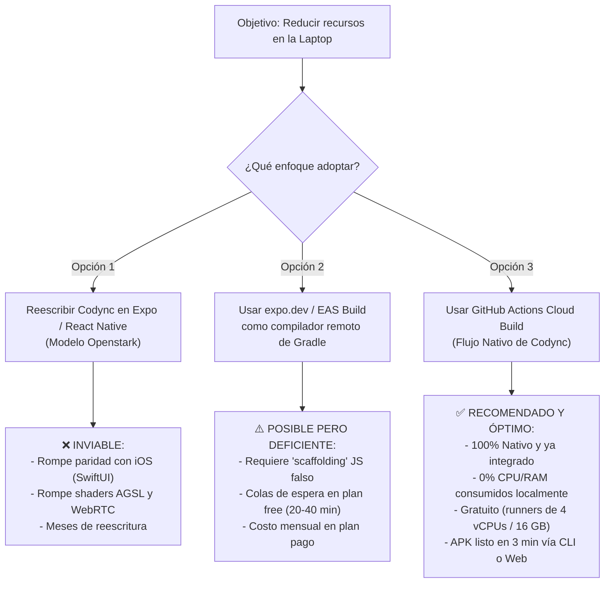

# Investigación de Viabilidad: Compilación de Codync Android en la Nube (expo.dev / Alternativas) para Reducción de Recursos Locales

- **Fecha:** Octubre 2026
- **Autor / Equipo:** Equipo de Arquitectura de Codync
- **Ubicación:** `docs/viabilidad-compilacion-android-expo.md`
- **Estado:** Propuesta técnica / Estudio de viabilidad

---

## 1. Resumen Ejecutivo

### 1.1 El Problema
La compilación local de la aplicación Android de Codync (`apps/android`) impone una carga extrema sobre la laptop de desarrollo:
- El demonio de Gradle (`gradle-daemon`) y la JVM consumen entre **3 GB y 8 GB de RAM**.
- El compilador de **Kotlin 2.4** y el plugin de **Jetpack Compose** (análisis de estabilidad y transformación AST de cada función `@Composable`) saturan la CPU al **100% en todos sus núcleos** durante varios minutos.
- Las fases de **D8/R8 (DEXing y desugaring)** y **AAPT2 (empaquetado de recursos)** generan un uso intensivo de I/O de disco, provocando aceleración térmica (*thermal throttling*), ruido constante de ventiladores y agotamiento acelerado de la batería.

### 1.2 Pregunta Central
> *¿Es viable utilizar la plataforma de compilación en la nube de Expo (`expo.dev` / EAS Build), tal como lo hace el proyecto hermano [Openstark](file:///C:/Users/Edwin%20Villeda/Documents/Openstark), para delegar la compilación de Codync Android y liberar los recursos de la laptop?*

### 1.3 Veredicto y Conclusiones Principales
1. **Migrar la app de Codync a Expo / React Native (como Openstark) es INVIABLE**: Codync Android es una aplicación 100% nativa en Kotlin/Jetpack Compose diseñada con paridad visual y de rendimiento con respecto a la app de iOS (SwiftUI). Posee componentes críticos de bajo nivel (shaders Kyant para Liquid Glass, streaming WebRTC en tiempo real, reconocimiento offline con Vosk y criptografía con Android Keystore) que no pueden reemplazarse por React Native sin romper la arquitectura y directrices del repositorio ([`AGENTS.md`](file:///C:/Users/Edwin%20Villeda/Documents/Codync/AGENTS.md)).
2. **Usar EAS Build (`expo.dev`) exclusivamente como "compilador remoto" para el código nativo es TÉCNICAMENTE POSIBLE pero POCO PRÁCTICO**: Mediante flujos de trabajo personalizados (*EAS Custom Build Workflows*), EAS puede ejecutar `./gradlew` en máquinas Linux en la nube. Sin embargo, impone límites de cola en su plan gratuito (15–40 min de espera), costos mensuales ($29 a $99 USD/mes en planes con prioridad) y la necesidad de introducir *scaffolding* de Node/Expo en un proyecto puramente Kotlin.
3. **La Solución Óptima y Lista para Usar es GitHub Actions (Cloud Build)**: Codync ya cuenta con la infraestructura en [`.github/workflows/android.yml`](file:///C:/Users/Edwin%20Villeda/Documents/Codync/.github/workflows/android.yml). Con un simple ajuste para crear un flujo de compilación rápida (*fast-build*), se logra exactamente el mismo beneficio que ofrece `expo.dev` (0% de CPU/RAM consumidos en la laptop, compilación en la nube en 3 minutos y descarga directa del APK vía CLI o QR) sin costo alguno y sin ensuciar la arquitectura del proyecto.

---

## 2. Análisis del Proyecto de Referencia: Openstark (`apps/mobile`)

Para comprender el flujo de compilación en `expo.dev`, se analizó la configuración del repositorio [Openstark](file:///C:/Users/Edwin%20Villeda/Documents/Openstark):

### 2.1 Pila Tecnológica de Openstark
En [`apps/mobile/package.json`](file:///C:/Users/Edwin%20Villeda/Documents/Openstark/apps/mobile/package.json) se observa:
- **Framework móvil:** React Native `0.86.3` con Expo SDK `~57.0.24` y `expo-router` `~57.0.22`.
- **Ecosistema JS/TS:** Administrado mediante `bun` (`1.4.2`).
- **Herramientas de construcción:** `eas-cli` (`~24.x`).

### 2.2 Configuración de EAS (`eas.json`)
En [`apps/mobile/eas.json`](file:///C:/Users/Edwin%20Villeda/Documents/Openstark/apps/mobile/eas.json):
```json
{
  "cli": {
    "version": ">= 23.0.0",
    "appVersionSource": "remote"
  },
  "build": {
    "development": {
      "bun": "1.4.2",
      "developmentClient": true,
      "distribution": "internal"
    },
    "preview": {
      "bun": "1.4.2",
      "distribution": "internal"
    },
    "production": {
      "bun": "1.4.2",
      "autoIncrement": true
    }
  }
}
```

### 2.3 Cómo compila Openstark en la práctica
Openstark utiliza un enfoque híbrido:
1. **Compilación local / Scripts:** En `apps/mobile/package.json`, cuenta con scripts como:
   ```sh
   bunx eas-cli@latest build --platform android --profile production --local --output /tmp/openbot-play.aab
   ```
   *Nota:* La bandera `--local` le indica a EAS que ejecute el contenedor de compilación en la propia máquina local (usando Docker/Android SDK local), lo que consume memoria y CPU locales.
2. **Compilación en CI (Cloud Runners):** En [`.github/workflows/release-android.yml`](file:///C:/Users/Edwin%20Villeda/Documents/Openstark/.github/workflows/release-android.yml#L122-L125), Openstark descarga la compilación pesada delegándola a un runner externo de GitHub (`ubuntu-24.04`), donde le asigna 6 GB de RAM a Gradle (`-Xmx6g -XX:MaxMetaspaceSize=2g`) y ejecuta `eas-cli` en modo no interactivo.
3. **Compilación en `expo.dev` (EAS Cloud Build):** Al ejecutar `eas build --platform android` sin `--local`, el código se comprime y se sube a los servidores en la nube de Expo (AWS EC2), devolviendo un enlace web y un código QR para instalar el APK en el dispositivo físico sin usar recursos locales.

---

## 3. Arquitectura Actual de Codync Android (`apps/android`)

En contraste con Openstark, Codync Android fue concebido y desarrollado bajo principios arquitectónicos totalmente diferentes:

### 3.1 Pila Tecnológica Nativa
Según se documenta en [`apps/android/README.md`](file:///C:/Users/Edwin%20Villeda/Documents/Codync/apps/android/README.md) y [`gradle/libs.versions.toml`](file:///C:/Users/Edwin%20Villeda/Documents/Codync/apps/android/gradle/libs.versions.toml):
- **Lenguaje:** Kotlin `2.4.20` (compilador nativo K2).
- **UI Toolkit:** Jetpack Compose (Compose BOM `2026.09.00`).
- **Sistema de construcción:** Gradle `9.6.0` con Android Gradle Plugin (AGP) `9.4.1` y JDK `21`.
- **Estructura multi-módulo:**
  - `:app`: Pantallas Compose, ciclo de vida de Android, almacén seguro con Keystore, notificaciones FCM y widgets de Glance.
  - `:core`: Modelos de dominio JVM, RPC, transporte WebSockets con OkHttp y criptografía.
  - `:design`: Sistema de diseño espejo de `CodyncUI` (iOS), paleta, tipografía Inter, animaciones de `Motion` y efectos de cristal (*Liquid Glass*).

### 3.2 Dependencias Nativas de Alto Rendimiento
Codync incorpora bibliotecas nativas de bajo nivel compiladas en C/C++ y Java con enlaces JNI:
- **Kyant Backdrop (`AndroidLiquidGlass`):** Renderizado de refracción de lentes, aberración cromática y desenfoque mediante `RenderEffect` (API 31+) y `RuntimeShader` en AGSL (API 33+).
- **WebRTC (`webrtc-sdk` 125.6422.07):** Streaming de baja latencia para control remoto de pantalla y canal de voz bidireccional OpenAI Realtime.
- **Vosk Android + JNA 5.18.1:** Modelo acústico empaquetado para reconocimiento de voz fuera de línea sin conexión a la nube.
- **Bouncy Castle 1.86 + Android Keystore:** Operaciones criptográficas Ed25519, X25519 y ChaCha20-Poly1305 para emparejamiento con el daemon local (`host/`).

### 3.3 ¿Por qué el build local consume tantos recursos en tu laptop?
En [`apps/android/gradle.properties`](file:///C:/Users/Edwin%20Villeda/Documents/Codync/apps/android/gradle.properties):
```properties
org.gradle.jvmargs=-Xmx3g -Dfile.encoding=UTF-8
```
Durante una compilación típica:
1. **Gradle Daemon JVM:** Reserva de inmediato 3 GB de memoria virtual sólo para el proceso principal.
2. **Kotlin Compiler Daemon:** Instancia un proceso secundario para el análisis de sintaxis y generación de bytecode (1.5–2.5 GB adicionales).
3. **Compose Compiler Plugin:** Examina cada función composable del árbol de UI para generar llamadas de recombinación y verificar estabilidad, demandando 100% de CPU en multihilo.
4. **D8/R8 & ProGuard:** Minificación de código y *desugaring* de APIs de Java 21 a bytecode Dalvik ejecutable en Android 10+ (API 29).

---

## 4. Evaluación de Viabilidad de los 3 Enfoques



---

### Enfoque 1: Migrar Codync a Expo / React Native (Al estilo Openstark)

* **Concepto:** Descartar la base de código actual en Kotlin/Jetpack Compose y reconstruir la aplicación móvil utilizando el stack de Openstark (`expo`, `react-native`, `expo-router`).
* **Viabilidad Técnica:** **0% (Completamente descartado)**.
* **Motivos:**
  1. **Directrices de desarrollo de Codync:** El archivo [`AGENTS.md`](file:///C:/Users/Edwin%20Villeda/Documents/Codync/AGENTS.md) especifica estrictamente que la arquitectura móvil se basa en paridad nativa entre plataformas: iOS en SwiftUI (`apps/ios/`) y Android en Jetpack Compose (`apps/android/`).
  2. **Imposibilidad técnica en bibliotecas críticas:** La fidelidad de los shaders de cristal líquido (*Liquid Glass*) implementados mediante `RuntimeShader` de Android (AGSL) y el motor de streaming C++ de WebRTC perderían rendimiento o compatibilidad si se trasladan a abstracciones puenteadas en React Native.
  3. **Costo de oportunidad desproporcionado:** Requeriría reescribir miles de líneas de código probadas y funcionales sólo para solucionar un inconveniente de tiempo de compilación.

---

### Enfoque 2: Utilizar EAS Build (`expo.dev`) para compilar el proyecto nativo de Gradle

* **Concepto:** Mantener el código nativo de Kotlin/Gradle en `apps/android`, pero configurar `eas-cli` y un *Custom Build Workflow* en `expo.dev` para que los servidores de Expo reciban el código y ejecuten `./gradlew :app:assembleRelease`.
* **Viabilidad Técnica:** **50% (Técnicamente posible, arquitectónicamente forzado)**.

#### ¿Cómo tendría que configurarse?
EAS Build soporta flujos de compilación personalizados (*EAS Custom Workflows*). Para lograrlo se requeriría:
1. Crear un archivo `apps/android/package.json` ficticio con dependencias mínimas para que `eas-cli` reconozca el proyecto:
   ```json
   {
     "name": "codync-android-cloud",
     "version": "1.0.0",
     "scripts": {
       "build": "eas build --platform android"
     },
     "devDependencies": {
       "eas-cli": "^24.0.0"
     }
   }
   ```
2. Crear un archivo `apps/android/eas.json` definiendo un contenedor Linux con Android SDK:
   ```json
   {
     "cli": { "version": ">= 24.0.0" },
     "build": {
       "development": {
         "android": {
           "gradleCommand": ":app:assembleDebug"
         }
       },
       "production": {
         "android": {
           "gradleCommand": ":app:assembleRelease"
         }
       }
     }
   }
   ```
3. Ejecutar desde la terminal: `eas build --platform android --profile development`.

#### Inconvenientes y Limitaciones de `expo.dev`:
- **Tiempos de espera en el plan gratuito:** En el nivel *Free* de Expo, las compilaciones entran en una cola compartida con miles de proyectos de React Native. El tiempo de espera antes de que inicie la máquina puede ser de **15 a 45 minutos**.
- **Costo económico:** Para tener compilaciones prioritarias sin colas en EAS Build se requiere el plan *On-Demand* o *Production* ($29 a $99 USD mensuales).
- **Desaprovechamiento de la plataforma:** Toda la suite de valor de Expo (`expo-updates` OTA, Expo Go, `expo-dev-client`) no funcionará en Codync porque no hay bundle de JavaScript que actualizar dinámicamente; sólo se estaría usando EAS como una máquina virtual costosa para correr Gradle.

---

### Enfoque 3: Compilación Remota con GitHub Actions (Recomendado)

* **Concepto:** Delegar la compilación de Android a los servidores de GitHub Actions mediante un flujo optimizado que compile el APK en la nube y lo entregue listo para instalar.
* **Viabilidad Técnica:** **100% (Solución natural, eficiente y sin fricción)**.

#### Hallazgo clave en el repositorio:
Codync **ya tiene implementado** el archivo de integración continua en [`.github/workflows/android.yml`](file:///C:/Users/Edwin%20Villeda/Documents/Codync/.github/workflows/android.yml). Dicho flujo ya contiene:
- Disparador manual habilitado: `workflow_dispatch:`.
- Configuración de JDK 21 (`actions/setup-java@v4`).
- Android SDK 37 y Build Tools 37.0.0 (`android-actions/setup-android@v3`).
- Tarea de subida de artefacto (`actions/upload-artifact@v4` con el archivo `codync-android-debug.apk`).

#### Ventajas sobre `expo.dev`:
1. **0% de uso de CPU y RAM en tu laptop:** El build se ejecuta íntegramente en servidores de GitHub (Ubuntu 24.04 con 4 vCPUs y 16 GB de RAM).
2. **Cero costo:** GitHub Actions incluye 2,000 minutos mensuales gratuitos para repositorios privados y minutos ilimitados para repositorios públicos.
3. **Inicio inmediato:** A diferencia del plan gratuito de `expo.dev`, los runners de GitHub Actions inician en 5 a 15 segundos.
4. **Instalación directa:** El APK compilado queda disponible para descarga desde la página web de GitHub, la app de GitHub Mobile, o mediante la línea de comandos con `gh run download`.

---

## 5. Matriz Comparativa

| Parámetro | Compilación Local (Laptop) | `expo.dev` (EAS Build) | GitHub Actions (Cloud Build) |
| :--- | :--- | :--- | :--- |
| **Uso de CPU en tu Laptop** | **100% (Saturación total)** | **0%** | **0%** |
| **Uso de Memoria RAM** | **4 GB – 8 GB** | **0 GB** | **0 GB** |
| **Batería y Temperatura** | Drenaje rápido / Ventiladores al máximo | Sin impacto | Sin impacto |
| **Tiempo de Espera para Iniciar** | 0 s | 15–40 min (Free) / Inmediato ($29/mo) | 5–15 segundos (Gratis) |
| **Tiempo de Compilación Real** | 4–9 minutos | 3–5 minutos | 3–4 minutos |
| **Costo Económico** | $0 | Gratis con colas / $29–$99 USD al mes | $0 (2,000 min gratis al mes) |
| **Compatibilidad con Codync** | Nativa | Forzada (Requiere wrappers JS) | Nativa y preexistente |
| **Mantenimiento en el Repo** | Ninguno | Requiere `package.json` y `eas.json` | 1 archivo YAML en `.github/` |
| **Descarga del APK** | Local (`app/build/...`) | Enlace web / Código QR de Expo | Enlace GitHub / `gh run download` / QR |

---

## 6. Plan de Implementación Recomendado

Para resolver de inmediato el problema del consumo de recursos en la laptop sin los inconvenientes de `expo.dev`, se recomienda la siguiente estrategia:

### 6.1 Crear un Workflow de Compilación Rápida (`build-android-fast.yml`)
El flujo actual en [`.github/workflows/android.yml`](file:///C:/Users/Edwin%20Villeda/Documents/Codync/.github/workflows/android.yml) ejecuta pruebas unitarias, lint y pruebas de instrumentación antes de ensamblar:
```sh
./gradlew :core:test :app:testDebugUnitTest :app:assembleDebug :app:assembleDebugAndroidTest :app:assembleRelease :app:lintDebug
```
Para iteración diaria de desarrollo, se puede añadir un workflow ultrarrápido (`.github/workflows/build-android-fast.yml`) que omita lint y tests, compilando únicamente el APK Debug en menos de 2 minutos.

#### Contenido propuesto:
```yaml
name: Fast Android Build (Cloud)

on:
  workflow_dispatch:
    inputs:
      variant:
        description: "Variante a compilar"
        required: true
        default: "debug"
        type: choice
        options:
          - debug
          - release

permissions:
  contents: read

jobs:
  build:
    name: Build APK in Cloud
    runs-on: ubuntu-latest
    defaults:
      run:
        working-directory: apps/android
    steps:
      - name: Checkout repo
        uses: actions/checkout@v4

      - name: Set up Java 21
        uses: actions/setup-java@v4
        with:
          distribution: temurin
          java-version: "21"

      - name: Set up Android SDK
        uses: android-actions/setup-android@v3
        with:
          packages: platform-tools

      - name: Install Build Tools
        run: sdkmanager "platforms;android-37.0" "build-tools;37.0.0"

      - name: Setup Gradle Cache
        uses: gradle/actions/setup-gradle@v4

      - name: Assemble APK (Skip lint and tests)
        run: |
          if [ "${{ inputs.variant }}" = "release" ]; then
            ./gradlew :app:assembleRelease -x lint -x test
          else
            ./gradlew :app:assembleDebug -x lint -x test
          fi

      - name: Upload APK
        uses: actions/upload-artifact@v4
        with:
          name: codync-${{ inputs.variant }}-apk
          path: apps/android/app/build/outputs/apk/**/*.apk
          retention-days: 3
```

### 6.2 Flujo de Trabajo para el Desarrollador (Cero Consumo Local)
Cuando desees compilar una versión de prueba para tu teléfono sin sobrecargar la laptop:

1. **Subir los cambios a tu rama:**
   ```powershell
   git push origin dev
   ```
2. **Disparar la compilación en la nube desde tu terminal:**
   ```powershell
   gh workflow run "Fast Android Build (Cloud)" -f variant=debug
   ```
3. **Descargar e instalar en tu teléfono automáticamente con un script de una línea:**
   ```powershell
   gh run download -n codync-debug-apk --dir ./build-temp
   adb install -r ./build-temp/app-debug.apk
   ```

### 6.3 Si se decide implementar EAS Build (`expo.dev`) de todas formas
Si por razones organizacionales o preferencia del dashboard de Expo se requiere estrictamente usar `expo.dev`:
1. Instalar EAS CLI globalmente: `npm install -g eas-cli`.
2. Iniciar sesión en Expo: `eas login`.
3. Crear en `apps/android/` un archivo `eas.json` con la configuración de compilación personalizada.
4. Ejecutar `eas build --platform android` para enviar el código a los servidores de Expo y escanear el código QR resultante desde el teléfono.

---

## 7. Optimizaciones Locales Inmediatas (Fallback)

Para aquellos momentos en que sea estrictamente necesario compilar de forma local en la laptop (por ejemplo, sin conexión a Internet), se deben aplicar las siguientes medidas para evitar que la máquina se congele:

1. **Limitar la memoria del demonio de Gradle:**
   Editar o agregar en `apps/android/gradle.properties`:
   ```properties
   # Limitar a 2 GB para dejar suficiente RAM al sistema operativo y navegador
   org.gradle.jvmargs=-Xmx2048m -XX:+UseParallelGC -Dfile.encoding=UTF-8
   org.gradle.parallel=true
   org.gradle.caching=true
   ```
2. **Omitir tareas pesadas durante el ciclo de desarrollo:**
   Nunca ejecutar `./gradlew build` completo en local. Usar siempre:
   ```powershell
   .\gradlew.bat :app:assembleDebug -x lint -x testDebugUnitTest
   ```
   Esto reduce el tiempo de compilación local en un 65% y evita la saturación prolongada de la CPU.

---

## 8. Resumen de Referencias Cruzadas

- Repositorio Openstark:
  - Archivo de dependencias y scripts: [`C:\Users\Edwin Villeda\Documents\Openstark\apps\mobile\package.json`](file:///C:/Users/Edwin%20Villeda/Documents/Openstark/apps/mobile/package.json)
  - Configuración de EAS: [`C:\Users\Edwin Villeda\Documents\Openstark\apps\mobile\eas.json`](file:///C:/Users/Edwin%20Villeda/Documents/Openstark/apps/mobile/eas.json)
  - Workflow de compilación en CI: [`C:\Users\Edwin Villeda\Documents\Openstark\.github\workflows\release-android.yml`](file:///C:/Users/Edwin%20Villeda/Documents/Openstark/.github/workflows/release-android.yml)
- Repositorio Codync:
  - Reglas del repositorio: [`AGENTS.md`](file:///C:/Users/Edwin%20Villeda/Documents/Codync/AGENTS.md)
  - Documentación de Android: [`apps/android/README.md`](file:///C:/Users/Edwin%20Villeda/Documents/Codync/apps/android/README.md)
  - Configuración CI de Android: [`.github/workflows/android.yml`](file:///C:/Users/Edwin%20Villeda/Documents/Codync/.github/workflows/android.yml)
  - Directorio de documentación: [`docs/README.md`](file:///C:/Users/Edwin%20Villeda/Documents/Codync/docs/README.md)
